# wxd.files.winforms · 多窗格文件管理器 + 配置表阅读器

一款 Windows 桌面工具，把日常要用的四件事装进一个程序：**多窗格文件管理**、**CSV/Excel 配置表查阅与编辑**、**SVN/Git 版本差异对比**、**GB 级日志分析**。

主要用户是游戏策划。核心设计只有一句话：

> 表格左侧的行号列显示的是**源文件物理行号**，和文本编辑器、Excel、`git diff` 里的行号一一对上。

查配置表时不用再问"第几行来着"——看到 `L31` 就能直接在源文件里定位到 `L31`。

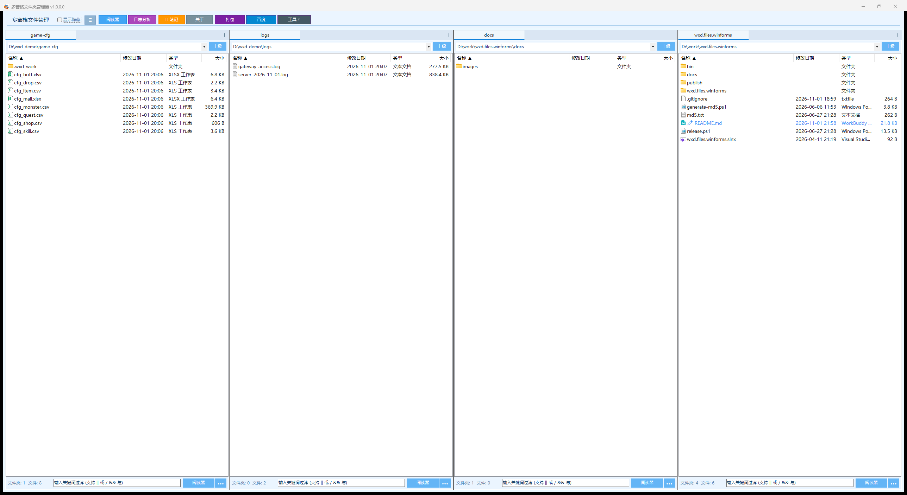

## 目录

- [为什么不直接开 Excel](#为什么不直接开-excel)
- [功能地图](#功能地图)
- [截图导览](#截图导览)
- [精要功能表](#精要功能表)
- [快速开始](#快速开始)
- [配置存储](#配置存储)
- [性能与已知取舍](#性能与已知取舍)
- [项目结构与模块文档](#项目结构与模块文档)

## 为什么不直接开 Excel

| 场景 | 直接用 Excel | 用这个工具 |
| --- | --- | --- |
| 定位一行配置 | 数格子，和文本编辑器行号对不上 | 行号列 = 源文件物理行号，可点选标记、可跳转、可按 `@line` 过滤 |
| 跨表引用是否正确 | 手工 VLOOKUP | **列关联**：配好一次，不匹配的单元格直接标红，悬停看映射，右键跳目标表 |
| 版本改了什么 | 导出两份再肉眼比 | **历史对比**：SVN/Git 任选版本双栏 diff，差异单元格标红、差异行标黄，行号口径与阅读器一致 |
| 合并冲突 | 记事本里手改 | **冲突三栏视图**：远程 / 本地 / 合并结果，整行或逐单元格取一侧，改完直接保存 |
| GB 级日志 | 打不开 | 流式读取 + 虚拟滚动，搜索、上下文行、格式化、反向导出 |

## 功能地图

| 模块 | 入口 | 解决什么 |
| --- | --- | --- |
| 多窗格文件管理 | 主窗口 | 1~10 个窗格并行浏览目录，集成 Windows 原生右键菜单 |
| 新建文件/文件夹 | 窗格底部 **＋** / 空白处右键 / `Ctrl+Alt+N`、`Ctrl+Shift+N` | 背景菜单含 新建文件夹 / 文本文档 / CSV / JSON / Markdown / 其他文件… |
| 搜索 | `···` → **搜索** / `Ctrl+F` | 递归搜文件名或内容，支持通配/正则、大小与时间过滤，结果双击定位 |
| 批量重命名 | 多选后 `F2` / `···` | 查找替换（含正则、捕获组）、模板、序号、实时预览、冲突拦截、可撤销 |
| 传输中心 | `···` → **传输中心** | 复制/移动排队执行，可暂停/取消；同名冲突可覆盖/跳过/重命名并全部应用 |
| CSV/Excel 阅读器 | 工具栏 **阅读器** | 配置表查阅、过滤、排序、编辑、跨表关联校验 |
| 行号定位 | 阅读器左侧行号列 | 物理行号标记 / 跳转 / `@line` 表达式过滤 |
| 版本历史对比 | 文件树右键 **历史记录对比** | SVN/Git 双栏差异，行号同源 |
| 冲突解决 | 文件树右键 **编辑冲突** | 三栏合并，逐单元格取舍 |
| 日志分析 | 工具栏 **日志分析** | 超大文本文件浏览、搜索、导出、格式化 |
| 文本比对 | 工具栏 **文本比对** | 文本文件按行对比；csv/xlsx 按表格逐单元格对比，可只看差异行 |
| JSON 工具 | 工具栏 **JSON** | 格式化 / 折叠 / 搜索 / 递归 key 排序，只读预览 |
| 笔记 | 工具栏 **📝 笔记** | 随手记 + 富文本粘贴截图，标题/内容全文搜索 |
| 自定义命令 | **≡ → 命令管理** | 把常用脚本、网址做成工具栏按钮 |
| 自动更新 | 工具栏 **关于** | 每天自动检查 Release（Gitee 优先，失败自动改用 GitHub），可跳过版本 |

---

## 截图导览

### 1. 主窗口：多窗格文件管理

四个窗格分别是配置表目录、日志目录、文档目录、仓库根目录。工具栏固定项是 `显示隐藏`、`≡`（展开设置面板：窗格数量 / 布局方式 / 主题 / 保存状态 / 命令管理）、`阅读器`、`日志分析`、`📝 笔记`、`关于`；后面的 `打包`、`百度`、`工具 ▾` 是用「命令管理」自己加出来的自定义命令按钮（填了同一个分组名的命令会折成一个 `组名 ▾` 下拉）。

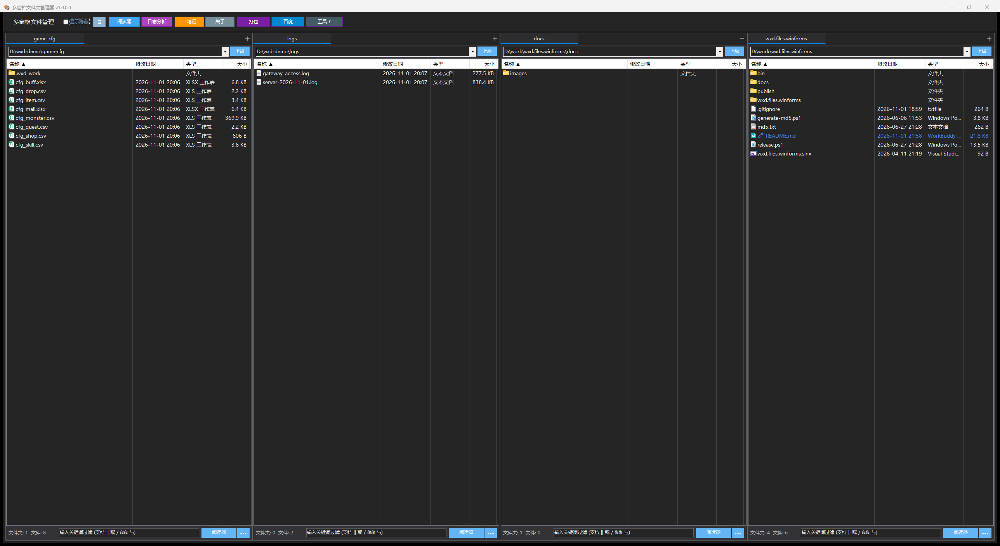

- 每个窗格独立目录、独立过滤、独立视图；最多 10 个窗格，每窗格最多 10 个页签
- 路径下拉框 = 磁盘切换 + 最近访问（最多 15 条）+ 手动输入回车跳转，支持 UNC 网络路径
- 面包屑：长文件夹名按可用宽度省略，层级过深时把中间段折叠成“…”下拉，不会挤出窗格或遮住「上级」
- 每窗格独立前进/后退历史（`Alt+←/→`、`Backspace` 上级）和路径面包屑
- 右键文件/文件夹走 **Windows 原生菜单**（含 SVN / Git 扩展，支持多选）
- 支持 `Ctrl+C/X/V` 剪贴板、`Ctrl+Shift+N` 新建文件夹，以及窗格内/窗格间/与资源管理器互拖
- 五种视图：详细信息 / 列表 / 大图标 / 小图标 / 平铺；`F2` 重命名、`F5` 刷新、`Delete` 删除、`Ctrl+A` 全选

### 2. CSV/Excel 阅读器

左侧目录树（带别名）+ 右侧多标签页表格。

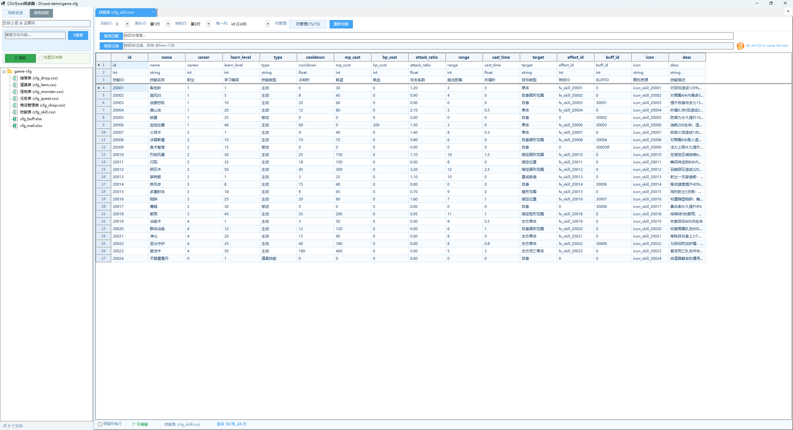

截图里的技能表：冻结行 `1/2/3` 分别是字段名、字段类型、中文标题，数据从 `L4` 开始。工具条依次是 **冻结行 / 表头行 / 映射行 / 唯一列 / 列管理 / 重新加载**，下面两行是内容过滤和高级过滤。

- 目录树节点带 VCS 状态前缀：`✏️` 已改 `➕` 新增 `➖` 删除 `⚠️` 冲突 `🆕` 未跟踪
- `🔄 更新` 直接在阅读器里对当前目录跑 SVN/Git 更新，`仅显示冲突` 一键过滤冲突文件
- 内容搜索遍历目录下所有表格，带进度条可取消，结果树点一下定位到匹配行

### 3. 行号 = 源文件物理行号 ⭐

这是整个工具的核心。高级过滤输入 `@line>=10 and @line<=24` 后：

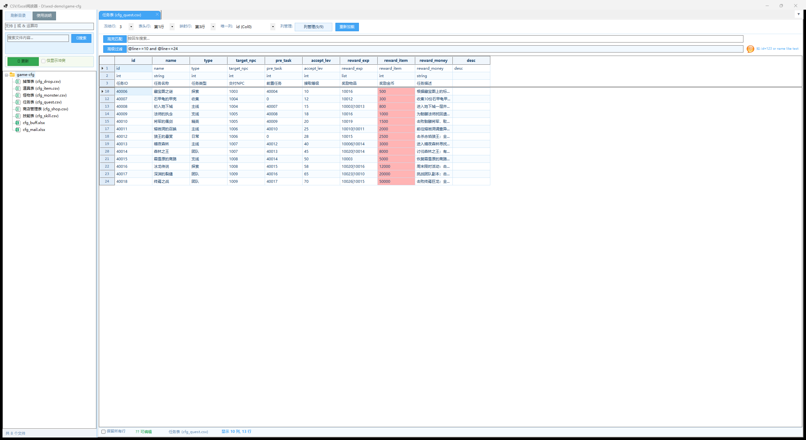

行号列显示 `10, 12, 13, 14, 15, 17, …`。缺掉的 `11`、`16` 不是丢数据——`L10` 和 `L15` 是**引号内换行的跨行记录**，续行不单独成行，整条记录按起始行号归类。状态栏回显"显示 10 列, 13 行"。

点击行号列弹出菜单：

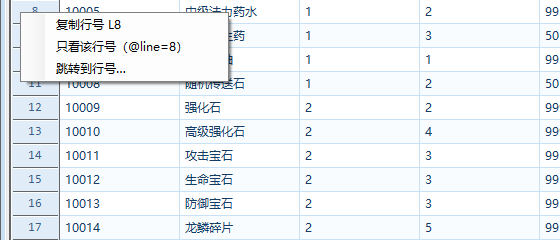

跳转到行号，对话框给出这张表的有效行号范围：


- **四处同源**：冻结行区、主体区、过滤结果、版本对比左右两栏取的是同一个行号取值函数，不会某一处错位
- 点击任意单元格或行号即标记整行（橙红描边），`Ctrl+点击` 多选，状态栏回显"已标记 N 行（源文件 L11–L14）"
- 标记**按物理行号记账**：过滤、排序、行内编辑提交、保存重试后仍落在同一行；被过滤隐藏的标记在条件清除后自动回到视图（新增/复制/删除行会改变行集合，标记随之清空）
- 无源行的位置（如插入的占位行）显示 `—`，不冒充行号

### 4. 冻结行 / 冻结列 / 列管理

52 列的怪物表，横向滚到右侧后，左侧冻结的 `id / name / race` 三列仍然钉住：

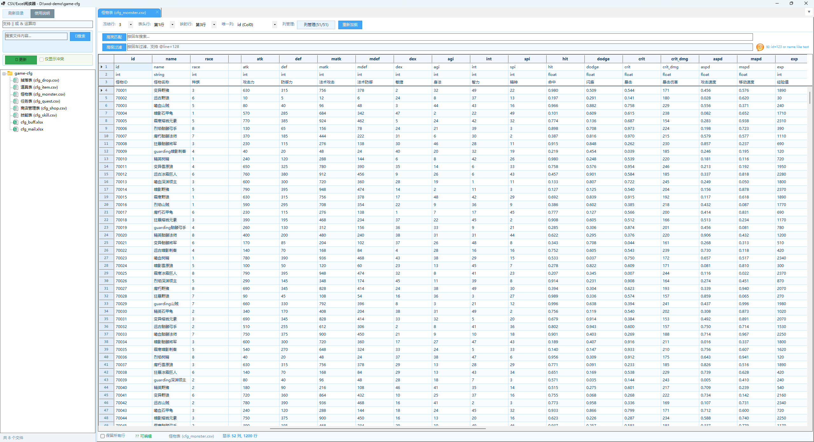

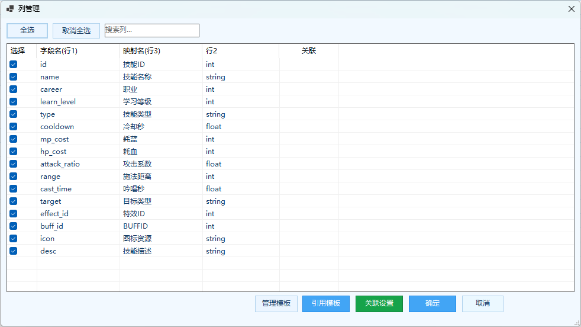

- **冻结行**：顶部 N 行不随滚动消失（0~10 行）；**表头行**指定其中哪一行当列标题；**映射行**指定哪一行做中文表头
- **冻结列**：右键任意单元格 / 列头 / 冻结行区域 → "冻结到此列（前 N 列）"或"取消冻结列"；隐藏列时冻结数自动收敛，始终至少留一列可滚动
- **列管理**：勾选显示列、搜索列、全选/取消全选，底部进 **关联设置 / 管理模板 / 引用模板**；列表按"字段名（行1）/ 映射名（行3）/ 行2"预览前几行便于认列，已关联的列有标记；行号列不参与显隐
- 冻结行、表头行、列显隐、冻结列数全部按目录/文件持久化，重开自动恢复

### 5. 单元格与行编辑

右键单元格/行的菜单：

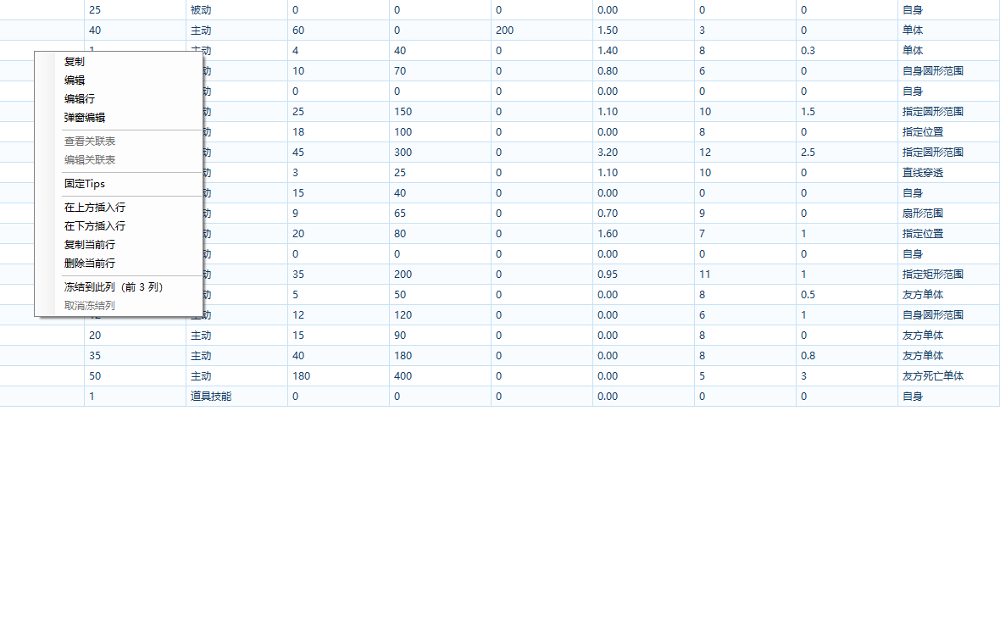

- CSV 支持双击编辑、弹窗编辑，改完自动写回（UTF-8）；小文件走原子写，避免中途失败留下半截文件
- 行级操作：**在上方/下方插入行、复制当前行、删除当前行**
- **固定 Tips**：把某段说明钉在角落常驻，边改边看
- Excel 文件只读，不做写回

### 6. 列关联（跨文件校验）⭐

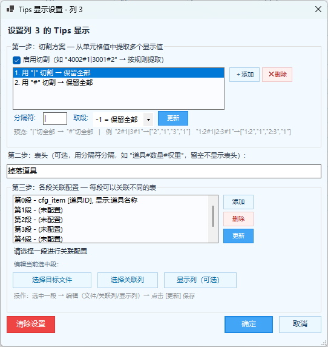

入口是 **列管理 → 关联设置**，对话框按三步走：**第一步 切割方案**（从单元格值里提取多个显示值）、**第二步 表头**（这列在表格里显示的中文名）、**第三步 各段关联配置**（每段分别选目标文件 / 关联列 / 显示列）。效果是匹配的正常色、不匹配的标红——上面 `@line` 过滤那张图里，任务表 `reward_item` 列整列标红，就是关联到道具表后值对不上的效果。

- **值提取规则**：先按 `|` 拆多值，每组再按 `#` 取段。例如 `100500201#1|100500202#1` → `100500201`、`100500202`
- 悬停单元格显示关联表信息（ID→显示名映射、匹配数量统计），右键可**查看关联表**、直接**编辑关联表**
- **关联模板**：同一套关联规则复用到多张表，不用逐表配（列管理里的 管理模板 / 引用模板）

**唯一列**用来查重：设了唯一列后加载/保存会检查重复值，弹窗按"重复值 / 次数 / 所在行号"列出明细（行号同样是源文件物理行号），双击某行跳回对应位置，可一键复制到剪贴板：

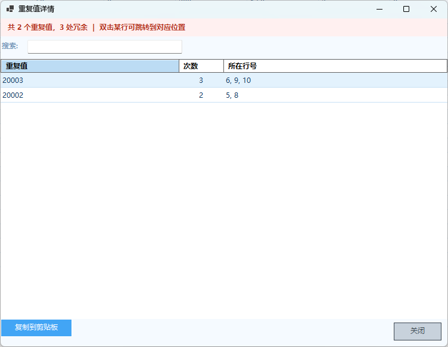

### 7. 版本历史对比（SVN / Git）

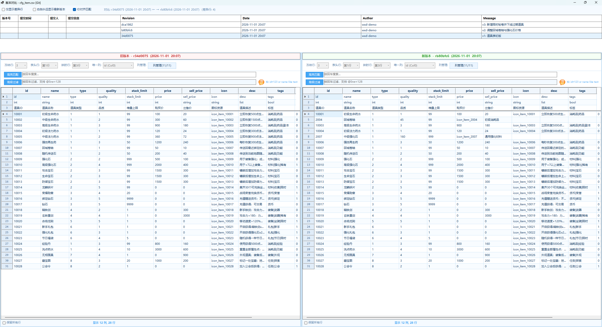

顶部历史表列出版本号 / 提交时间 / 提交人 / 提交信息，选中即在下方加载双栏对比；左旧右新，标题栏回显"对比: 旧版本 ←→ 新版本（差异行: N）"。三个开关：**仅显示差异行**、**右侧永远是显示最新版本**（右侧固定为工作目录里的文件）、**ID对齐匹配**（按唯一列 ID 而不是按行位置配对，插入/删除行不会让整表错位）。

差异配色（下图更清楚）：

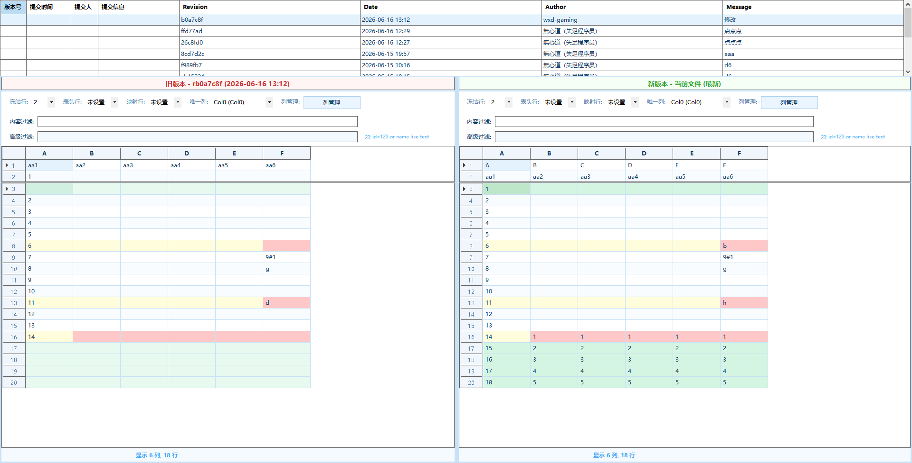

- 差异单元格红色，差异行的其他单元格浅黄，无差异行正常；冻结行始终显示且参与比较
- `仅显示差异行` 隐藏无差异行（冻结行始终保留）
- 左右两栏垂直/水平同步滚动；行号同样是源文件物理行号，同样能用 `@line` 只看一段
- 列显隐继承原表，也可在对比中独立切换
- 已加载的版本自动缓存（最多 10 个），来回切版本不用重新导出；加载/算差异时有独立旋转动画，不阻塞界面
- 前置条件：目录受 SVN 或 Git 管控（自动检测 `.svn` / `.git`），依赖命令行工具 `svn.exe` / `git.exe`

### 8. 冲突解决三栏视图

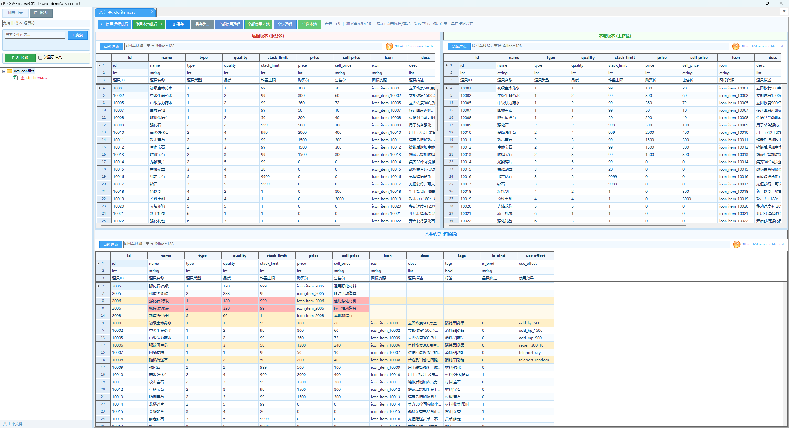

冲突文件在阅读器里以 `⚠️ 冲突: xxx.csv` 页签打开：上方左**远程版本（服务器）**、右**本地版本（工作区）**，下方是**合并结果（可编辑）**。工具栏提供 `← 使用远程此行` / `使用本地此行 →` / `全部使用远程` / `全部使用本地` / `全选远程` / `全选本地` / `保存` / `另存为`，标题栏回显"差异行: 9 | 冲突单元格: 10"。

操作方式：点远程或本地的一行选中它，再点工具栏按钮整行合并；右键则提供更细的 `使用此行` / `使用此单元格` / `编辑单元格` / `删除行`。合并结果表同样是完整的表格控件，冻结行、行号、高级过滤（`@line`）都在，改完直接保存回文件。

### 9. 日志分析（大文件阅读器）

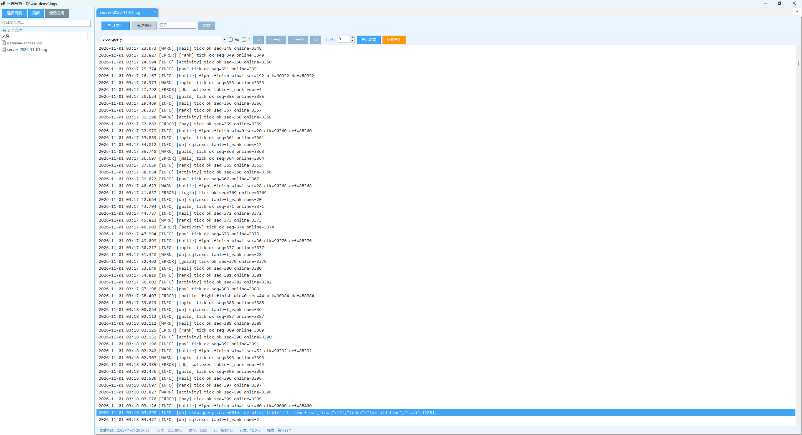

- 10GB+ 文本/日志秒级打开，分块流式读取 + 虚拟滚动，后台异步建行偏移索引
- 搜索：关键词 / 区分大小写（`Aa`）/ 正则（`.*`），上一条·下一条跳转，可带上下文行（`上下行`），状态栏回显"第 1/29 个"
- **导出结果**与**反向导出**（排除匹配行，保留其余全部行）
- 双击某行打开行详情，里面的 **格式化** 把 JSON 美化缩进、`【】`块拆分，RTF 语法高亮显示
- 单行超长时列表按 8KB 截断显示，弹窗里看全文（上限 64MB）

### 10. 笔记

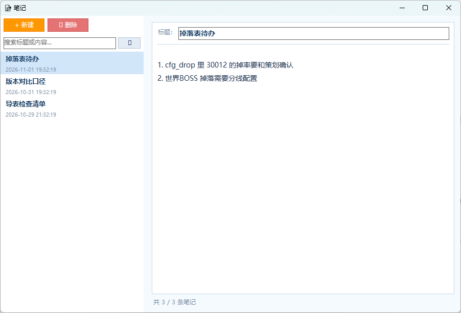

左侧列表（标题 + 更新时间 + 搜索框），右侧富文本编辑，支持 `Ctrl+V` 直接粘贴 QQ 截图；编辑即后台自动写盘。

### 11. 自定义命令

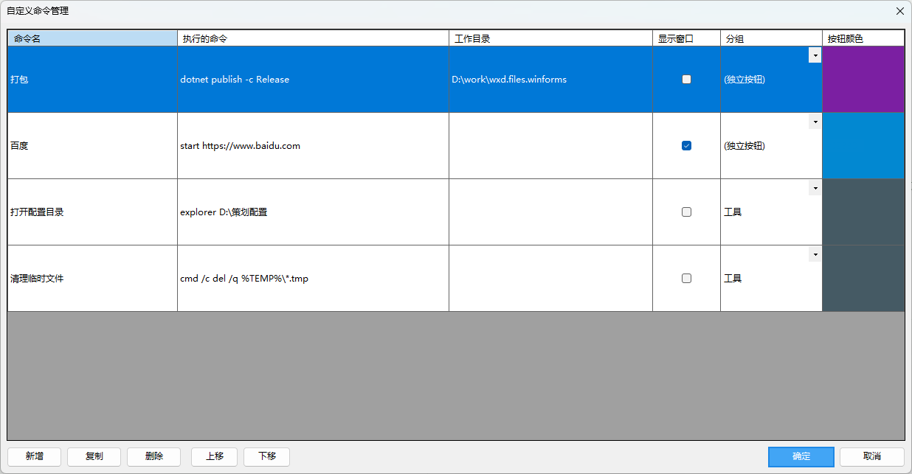

表格化编辑：名称 / 执行命令 / 工作目录 / 是否显示 cmd 窗口 / 按钮颜色 / **分组**（留空 = 独立按钮，同名折成下拉），一条记录可写多行命令依次执行；保存后工具栏出现对应按钮。

### 12. 关于与自动更新

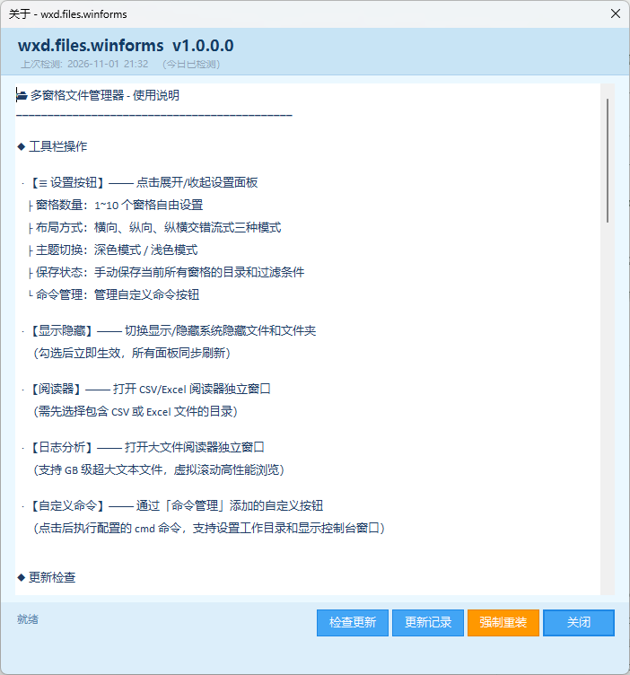

「关于」窗口内置完整使用说明，同时是更新入口：启动时每天自动检查一次 Release，Gitee 优先、连不上时自动改用 GitHub 镜像，发现新版本弹出更新内容与"立即更新 / 跳过版本 / 取消"，支持强制重装当前版本。

---

## 精要功能表

### 多窗格文件管理
- 1~10 窗格；横向 / 纵向 / 纵横交错流式三种布局；3·5·7 窗格走"左流式 + 右占满高度"特例
- 每窗格独立目录、过滤、视图、页签；活动窗格蓝框高亮
- 过滤框支持 `||`（或）与 `&&`（与），词首/词尾的 `*` 可锚定（`1.3.*` 只要开头、`*3.1` 只要结尾），忽略大小写，`Esc` 清空，300ms 防抖
- 显示/隐藏系统隐藏文件；双击文件夹进入，双击文件用系统默认程序打开
- 窗格底部 **＋** 与文件夹空白处右键打开窗格背景菜单：新建（文件夹 / 文本文档 / CSV / JSON / Markdown / 其他文件…）、粘贴、刷新、查看、排序、属性；选中文件、选中文件夹仍走 Windows 系统项菜单
- Windows 11 的“现代”右键菜单由 Explorer 私有宿主绘制，第三方程序只能拿到经典菜单；经典背景菜单里的“新建”子菜单在第三方宿主中为空，因此空白处使用内置背景菜单，文件/文件夹的系统项菜单不受影响
- 快捷新建：`Ctrl+Shift+N` 新建文件夹（默认名后就地重命名），`Ctrl+Alt+N` 新建文件（输入框即时校验非法字符、保留名与重名）
- 搜索（`Ctrl+F`）：递归子目录，按文件名通配/正则或内容行搜索，可加大小、修改时间、隐藏文件条件；结果带物理行号，双击跳回所在目录并选中
- 批量重命名（多选 `F2`）：查找替换 / 正则捕获组 / 模板 `{name}{ext}{counter}{date}` / 序号 / 大小写；执行前两栏预览并拦截重名与非法字符，执行后可一键撤销
- 复制/移动进传输队列：后台执行不卡界面，`··· → 传输中心` 查看进度、暂停、取消；同名冲突支持覆盖 / 跳过 / 重命名 / 保留较新者，并可对全部同类冲突应用

### CSV/Excel 阅读器
- 文件树异步加载 + 关键词过滤；标签页多开、`▼` 快速定位、逐个关闭
- 冻结行 / 表头行 / 映射行 / 唯一列 / 列管理 / 重新加载
- 列显隐、Excel 式冻结列、按文件持久化
- 行号定位：物理行号、点击标记、`Ctrl+多选`、右键菜单、跳转到行号、`@line` 表达式过滤
- 内容过滤（`||` `&&`）、高级过滤（`Col0>100`、`id=123`、`name like test`）、高亮匹配、`Esc` 清除
- 列关联跨表校验、值提取规则、关联模板、悬停浮窗、右键跳转
- 排序（升 / 降 / 无，冻结行始终在顶部）；单元格与行编辑；固定 Tips；文件别名
- 内容搜索（异步遍历 + 进度条 + 取消 + 结果树定位）
- 缓存挂在阅读器窗口实例上，**关窗即释放**；A、B 两个目录各持一份，互不共享互不失效
- 交互细节：横向滚到右侧后拖列宽只同步受影响列，不整表重绘跳回最左；加载遮罩移除后连同冻结行区一起重绘，不留白底

### 版本对比与冲突解决
- SVN / Git 历史列表、双栏差异、同步滚动、仅显示差异行、版本缓存、Loading 动画
- 冲突三栏视图，逐单元格取一侧，改完保存

### 日志分析
- 流式读取、虚拟滚动、行索引、行号跳转、搜索（含正则/上下文行）、导出与反向导出、JSON 格式化、文件分块

### 文本比对
- 工具栏 **文本比对** 打开独立窗口；左右两格各选一个文件，也可直接把文件拖进窗口或对应网格
- 文本文件（txt/xml/yaml/json/ini/log…）按行差分：修改行黄色、仅左侧有红色、仅右侧有绿色，另一侧用灰色占位行对齐
- **csv / xlsx / xls 走表格比对**：按行号一一对齐、逐单元格比较，只高亮发生变化的格子；不认表头行、不做冻结行，也不复用阅读器
- 行号列显示各自源文件行号；两侧滚动同步，长行悬停可看完整内容
- 勾选 **只保留差异行** 后只显示有差异的行，行号仍是原文件行号
- JSON / YAML 可勾选 **对比前按 key 排序**：JSON 递归排序并统一缩进，YAML 对块状映射保守排序（序列/块标量/锚点不排），只影响比对、不改磁盘文件
- 状态栏汇总左右行数/列数、修改（差异单元格数）/新增/删除数量
- 自动识别 UTF-8（含 BOM）与 GB18030（中文 GBK 配置表）

### JSON 工具
- 工具栏 **JSON** 打开独立窗口：左侧源文本、右侧可折叠 JSON 树
- 格式化（2 空格缩进）、压缩为一行、递归按 key 排序；中文不转义、数字保留原写法
- 搜索 key / 值：命中节点标红并展开祖先，上下切换命中（F3 / Shift+F3）
- 全部展开 / 全部折叠、复制结果、打开文件或直接拖入；Ctrl+O / Ctrl+F
- 保存 / 另存为（Ctrl+S）：按原文件编码写回，标题用 `*` 标未保存，关闭前提示
- 解析允许注释与尾逗号；语法错误给出行列位置

### 全局
- 深色 / 浅色主题即时切换（深色近 Visual Studio 风格，浅色清爽天蓝）
- 状态记忆：各窗格目录/过滤/视图、窗格数、布局、主题、显示隐藏开关、阅读器与日志分析上次目录、最近路径、自定义命令；关窗自动保存，重启自动恢复
- 启动 Loading 动画：分批异步加载并显示进度
- 统一提示框（可复制异常详情）

---

## 快速开始

### 环境
- Windows 10 / 11
- .NET 10.0 SDK 或更高
- 仅历史对比 / 冲突 / `🔄 更新` 需要：`svn.exe`（TortoiseSVN 安装时勾选 command line tools）或 `git.exe`（Git for Windows）

### 编译运行

```bash
git clone <repo-url>
cd wxd.files.winforms

dotnet restore
dotnet run --project wxd.files.winforms/wxd.files.winforms.csproj
```

用 Visual Studio 的话直接打开 `wxd.files.winforms.slnx`。

### 发布

```powershell
.\release.ps1 -Version "1.0.2.8" -ReleaseNotes "【优化】xxx"
```

脚本会 publish、算出 exe 的 MD5、打 tag 并把 `master` + tag 同时推到 Gitee 和 GitHub，再在两端各建一个 Release 并上传 exe 附件——Release 正文里的 `` **MD5**: `xxx` `` 就是客户端下载后的校验值来源。源码里的 `Version` 默认 `1.0.0.0`，实际发布版本由 `-p:Version=` 注入。首次运行会依次索要 `GITEE_TOKEN`（projects 权限）和 `GITHUB_TOKEN`（repo 权限）并写入用户环境变量；GitHub token 直接回车跳过则只发 Gitee。

## 配置存储

| 层级 | 位置 | 内容 |
| --- | --- | --- |
| 全局设置 | `{exe}/.wxd-work/settings.json`（旧 `dll.config` 只读兼容） | 主题、窗格数量、布局、各窗格页签状态、自定义命令、更新检查时间 |
| 最近路径 | `{exe}/.wxd-work/recent-paths.json` | 最近访问目录（最多 15 条），后台合并写 |
| 目录级配置 | 每个目录的 `.wxd-work/config.json` | 冻结行、表头行、映射行、唯一列、列关联、关联模板、文件别名、列显隐、冻结列数 |
| 诊断日志 | `{exe}/.wxd-work/logs/` | `crash_*.log` 崩溃现场；`operations.log` 文件操作入队/开始/失败原因（超过 2MB 自动重建） |

目录级配置和数据放在一起，**跟着文件夹移植**，换台机器不用重配；`.wxd-work` 首次配置时自动创建。最近路径全局最多保留 15 条。

## 性能与已知取舍

- 表格视图实测口径：**几千行流畅；约 3 万行可用但能感到迟滞；10 万行以上明显吃力**。表格视图**没有做虚拟滚动和分页**——超大文本请用日志分析模块。
- CSV 按 **UTF-8（识别 BOM）** 读取，写回也是 UTF-8；分隔符自动识别（逗号 / 制表符 / 分号等）；引号内换行的跨行记录按起始行归类，因此行号会自然跳号。
- Excel 只读，不支持编辑写回。
- 数据缓存随阅读器窗口释放：关掉窗口就没了，不做进程级常驻，也不做引用计数。
- 版本对比依赖本机 `svn.exe` / `git.exe`，只装 GUI 客户端（不带命令行工具）用不了。

## 技术栈

- **.NET 10.0**（`net10.0-windows7.0`）+ Windows Forms，C#，Nullable / ImplicitUsings 开启
- NuGet：`ExcelDataReader` 3.7.0、`ExcelDataReader.DataSet` 3.7.0、`MiniExcel` 1.37.0
- 外部命令行：`svn.exe` / `git.exe`
- 自动更新源：Gitee Releases API，失败自动回退 GitHub Releases API（双发布，两端内容一致）
- 编码：源码与数据文件统一 UTF-8

## 项目结构与模块文档

```
wxd.files.winforms/
├── Program.cs                        # 入口
├── Form1.cs                          # 主窗体：多窗格容器 + 工具栏
├── FileBrowserPanel.cs               # 单个窗格的文件浏览器控件
├── NewItemService.cs                 # 新建文件/文件夹的名称校验与创建
├── NewItemDialog.cs                  # 新建文件/文件夹输入框
├── TabbedFileBrowserPanel.cs         # 窗格的多页签容器
├── FileOperationQueue.cs             # 传输队列：FIFO、并发上限、暂停/取消
├── FileTransferEngine.cs             # 复制/移动/删除引擎：进度、冲突策略、校验、长路径
├── TransferCenterForm.cs             # 传输中心窗口
├── ConflictDialog.cs                 # 同名冲突询问框
├── FileSearchService.cs              # 递归搜索：名称通配/正则、内容行、大小/时间过滤
├── FileSearchForm.cs                 # 搜索窗口
├── BatchRenameEngine.cs              # 批量重命名：计划校验、两阶段执行、撤销
├── BatchRenameForm.cs                # 批量重命名窗口
├── CsvReaderForm.cs                  # CSV/Excel 阅读器窗体（持有本窗口表格缓存）
├── CsvReaderStandaloneForm.cs        # 独立表格窗体（关联跳转打开，无左侧树）
├── TableBrowserControl.cs            # 表格核心控件：冻结行/列、行号、过滤、编辑
├── TableBrowserOptions.cs            # 表格控件构造选项（根目录/缓存/轻量模式…）
├── FileDataCache.cs                  # 表格数据缓存（窗口实例级）
├── FileTableData.cs                  # 行模型 TableRow：携带源文件物理起止行号
├── CsvSettings.cs                    # 全局设置 + 目录级配置读写
├── DirectoryFrozenConfig.cs          # 目录冻结行配置模型
├── ColumnLinkConfig.cs               # 列关联配置模型
├── ColumnLinkChecker.cs              # 列关联校验与着色
├── ColumnLinkChecker_SimpleCsv.cs    # 关联校验的轻量 CSV 解析
├── ColumnLinkSetupDialog.cs          # 关联设置向导
├── LinkTableSelectorDialog.cs        # 目标表选择
├── TargetColumnSelectDialog.cs       # 目标列选择
├── LinkSourceMatcher.cs              # 判断关联配置是否指向当前文件
├── LinkTemplate / LinkTemplateManager / LinkTemplateDialog.cs   # 关联模板
├── DataGridLinkToolTip.cs            # 单元格悬停浮窗
├── ColumnManagerDialog.cs            # 列管理（显隐 + 关联入口）
├── CellEditDialog.cs                 # 弹窗编辑单元格
├── DuplicateDetailForm.cs            # 唯一列重复明细
├── LineNumberJumpDialog.cs           # 跳转到行号
├── VersionCompareForm.cs             # 历史版本对比窗体
├── VersionControlHelper.cs           # svn / git 命令行封装
├── VersionHistoryEntry.cs            # 版本历史记录模型
├── VcsStatusCache.cs                 # 目录 VCS 状态缓存（LRU + 异步刷新）
├── ConflictResolveControl.cs         # 冲突解决三栏视图
├── LargeFileViewer.cs                # 日志分析窗体
├── LargeFileReaderControl.cs         # 日志分析核心控件（流式读取 + 格式化）
├── TextCompareForm.cs                # 文本/表格比对窗体（左右双网格 + 差异着色）
├── TextDiffEngine.cs                 # 文本按行差分（裁剪前后缀 + Myers，超限退化整块替换）
├── TableDiffEngine.cs                # 表格按行对齐、逐单元格差分
├── SimpleTableReader.cs              # CSV/Excel 原始单元格读取（不认表头、不做冻结行）
├── TextFileReader.cs                 # 文本读取（按行 + UTF-8/GB18030 自动识别）
├── JsonToolForm.cs                   # JSON 工具窗体（源文本 + 可折叠树 + 搜索）
├── JsonToolEngine.cs                 # JSON 解析/格式化/压缩/递归 key 排序
├── LineListView.cs                   # 虚拟滚动行列表
├── FileSplitter.cs                   # 大文件分块读取
├── FileCacheStore.cs                 # 搜索结果缓存（内存 LRU + 磁盘）
├── SearchHistoryStore.cs             # 搜索历史
├── WindowsShellContextMenu.cs        # Windows 原生右键菜单集成
├── SimpleShellContextMenu.cs         # 简化版系统右键菜单
├── CustomCommandManagerForm.cs       # 自定义命令管理
├── CustomCommandItem.cs              # 自定义命令数据模型
├── NoteForm / NoteStore / NoteItem / NoteListItemControl.cs     # 笔记
├── AppStateStore.cs                  # 状态记忆（窗格/主题/最近路径）
├── TabPageState.cs                   # 单个页签的状态快照
├── AlertForm.cs                      # 统一提示框（模态）
├── UpdateForm / UpdateHelper / UpdateNotifyForm / ChangelogForm.cs  # 关于与自动更新
├── HelpForm.cs                       # 使用说明
├── AtomicFileWriter.cs               # 小文件原子写
├── NaturalStringComparer.cs          # 自然序比较
├── GlobalConst.cs                    # 全局常量（含 LfChar/CrChar/TabChar 换行常量）
├── skills/                           # 模块级设计文档（见下）
├── 需求.txt / 大文件阅读需求.txt      # 原始需求文档
├── App.config                        # 应用程序配置
├── app.ico                           # 应用程序图标
└── wxd.files.winforms.csproj         # 项目文件
```

> 主题（深色 / 浅色）没有独立窗体，由各窗体在 `ApplyTheme` 中统一取色，详见 `skills/ThemeSystem.md`。

### 模块设计文档（`wxd.files.winforms/skills/`）

改代码前先读对应文档，里面记了实现口径和踩过的坑：

| 文档 | 内容 |
| --- | --- |
| [CsvReader.md](wxd.files.winforms/skills/CsvReader.md) | 表格控件：冻结行双表格架构、行号口径、过滤链、已知坑（**最复杂模块**） |
| [VersionCompare.md](wxd.files.winforms/skills/VersionCompare.md) | 历史对比：差异编码、缓存 Key 约定、克隆约束 |
| [ConfigPersistence.md](wxd.files.winforms/skills/ConfigPersistence.md) | `.wxd-work/config.json` 双层持久化 |
| [FileBrowserPanel.md](wxd.files.winforms/skills/FileBrowserPanel.md) | 单窗格文件浏览 |
| [LargeFileViewer.md](wxd.files.winforms/skills/LargeFileViewer.md) | 大文件流式读取与虚拟滚动 |
| [TextCompare.md](wxd.files.winforms/skills/TextCompare.md) | 文本/表格比对：差分算法、对齐口径、编码识别 |
| [JsonTool.md](wxd.files.winforms/skills/JsonTool.md) | JSON 面板：格式化/折叠/搜索/key 排序 |
| [ThemeSystem.md](wxd.files.winforms/skills/ThemeSystem.md) | 深色 / 浅色主题体系 |
| [CustomCommand.md](wxd.files.winforms/skills/CustomCommand.md) | 自定义命令系统 |

开发规范总纲见 [skill.md](wxd.files.winforms/skill.md)。

## 许可证

Copyright © wxd-gaming
