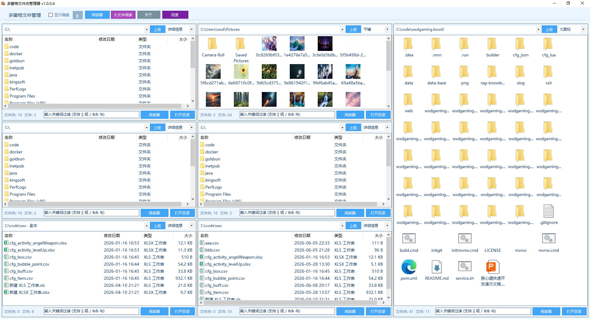
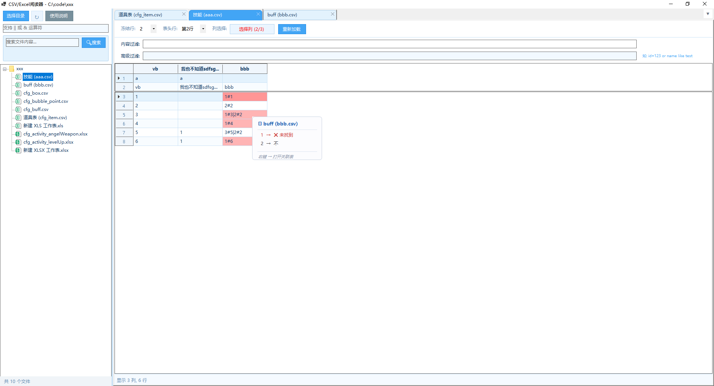
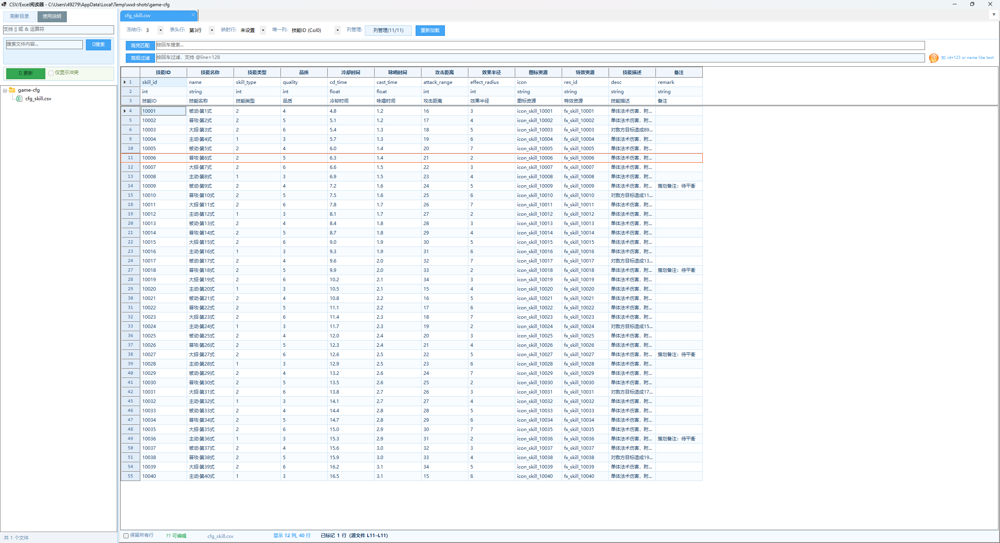
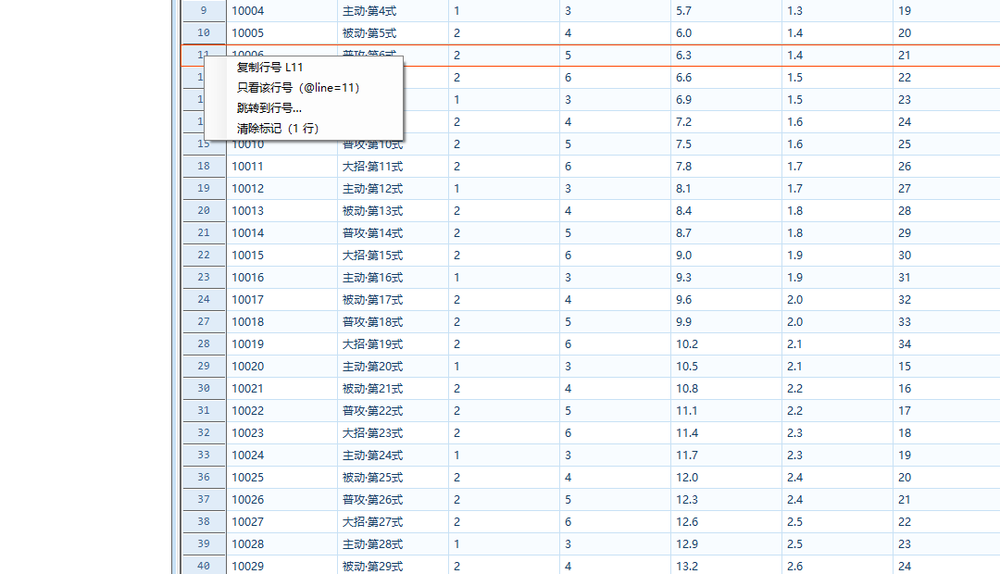
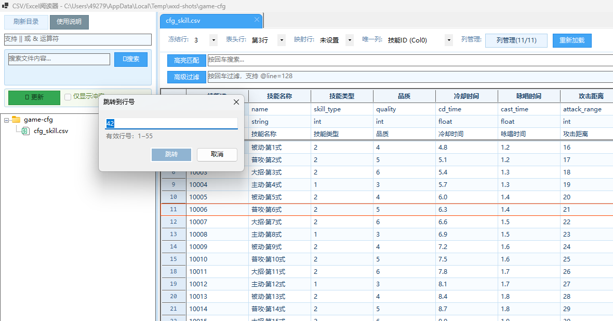
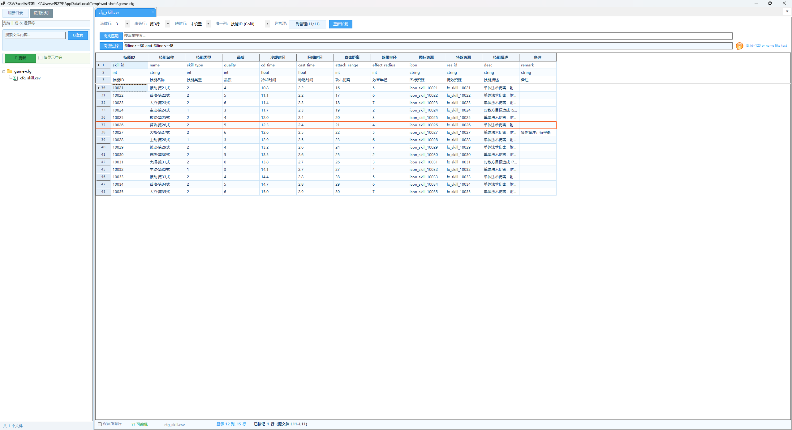
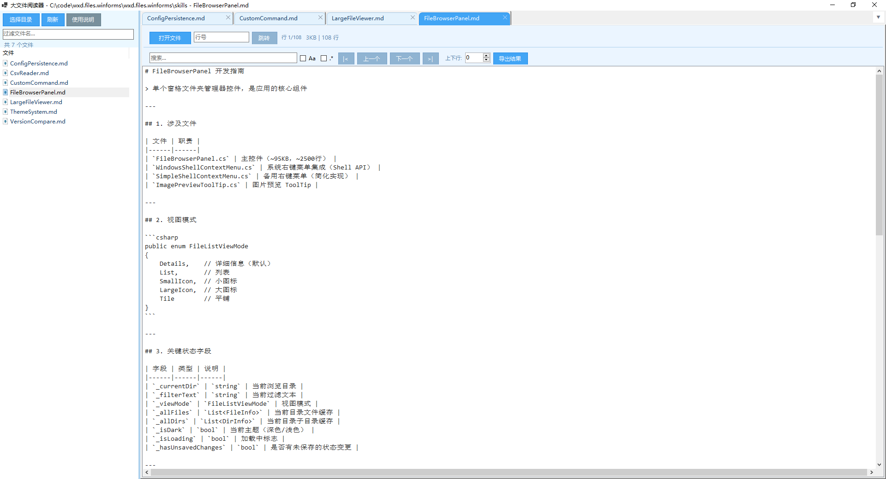
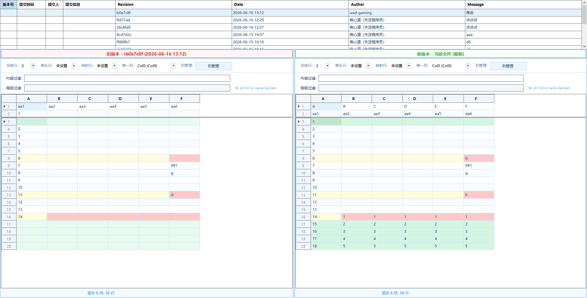
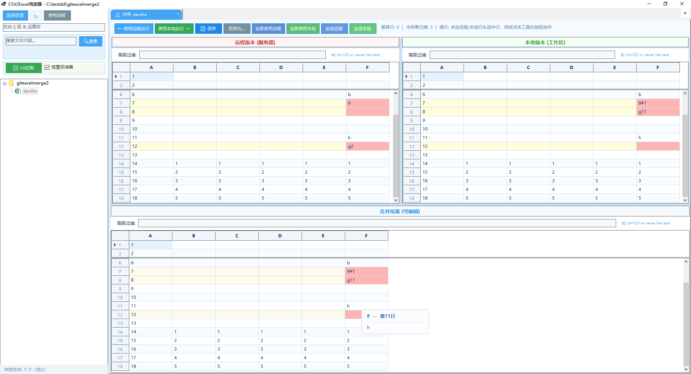
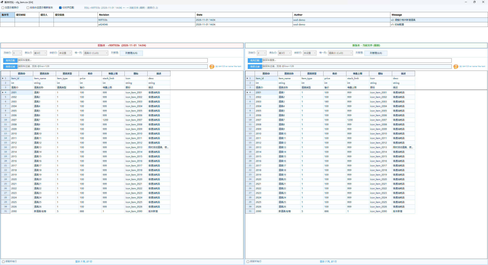

# wxd.files.winforms - 多窗格文件管理器

一款功能丰富的 Windows 文件管理工具，支持多窗格浏览、CSV/Excel 阅读、超大文件查看、自定义命令执行等多种功能。

主要用途：游戏开发策划的**配置表查阅**——表格视图左侧行号列显示的是**源文件物理行号**，可直接和文本编辑器、Excel、版本库里的行号对上。

## 预览截图

### 多窗格文件管理器主界面


### CSV/Excel 阅读器


### 行号定位：物理行号 + 标记 + 跳转
左侧行号列即源文件物理行号：冻结区是 `1/2/3`（三行表头元信息），数据区从 `4` 开始并在 `L6 → L9`、`L14 → L18` 处跳号——那是引号内换行的跨行记录。点击行号 `11` 后整行描橙红边，状态栏回显"已标记 1 行（源文件 L11–L11）"。



### 行号右键菜单



### 跳转到行号



### `@line` 行号表达式过滤

高级过滤框输入 `@line>=30 and @line<=48` 后只剩 15 行，行号 `30,31,32,33,36,37,…,45,46,47,48`。缺掉的 `34/35`、`43/44` 不是丢数据，而是 `L33`、`L42` 这两条跨行记录的续行——它们不单独成行，整条记录按起始行号归类。



### 大文件阅读器


### VCS 版本对比




版本对比左右两栏的行号同样是源文件物理行号，与阅读器口径一致：



## 功能特性

### 多窗格文件夹管理器
- **1~10 个窗格**自由设置，每个窗格独立管理文件夹
- **三种布局模式**：横向布局、纵向布局、纵横交错流式布局
- **特殊布局优化**：3/5/7 个窗格时采用左流式 + 右占满高度的智能排布
- **文件浏览**：双击文件夹进入，双击文件调用系统默认程序打开
- **五种视图模式**：详细信息、列表、小图标、大图标、平铺
- **路径下拉框**：集成磁盘切换 + 最近访问路径，支持手动输入回车跳转
- **向上导航**：一键返回上级目录
- **文件过滤**：支持关键词过滤，支持 `||`（或）和 `&&`（与）运算符，忽略大小写
- **系统右键菜单**：集成 Windows 原生右键菜单（SVN 更新、Git 操作等），支持多选操作
- **焦点高亮**：当前活动窗格蓝色边框高亮
- **键盘快捷键**：F2 重命名、F5 刷新、Delete 删除、Ctrl+A 全选
- **显示隐藏文件**：可切换显示/隐藏系统隐藏文件和文件夹

### CSV/Excel 阅读器

#### 文件树操作
- **文件树**：左侧树形展示目录及子目录下所有 CSV/Excel 文件
- **异步加载**：异步读取文件列表，避免界面卡死
- **文件过滤**：支持关键词过滤文件名，支持 `||`（或）和 `&&`（与）运算符，忽略大小写
- **右键菜单**：打开、编辑、打开文件夹、历史对比、设置备注名

#### 标签页管理
- **多标签页**：右侧同时打开多个 CSV/Excel 文件，标签页切换
- **▼ 下拉菜单**：快速定位已打开的标签页
- **关闭按钮**：每个标签页可独立关闭

#### 表格核心操作

##### 冻结行与表头行
- **冻结行**：顶部 N 行保持不动，不随滚动消失，可配置 0~10 行
- **表头行**：指定冻结行中某一行作为列标题显示（如第2行为中文标题）
- **配置持久化**：自动保存到 `.wxd-work/config.json`，随目录移植

##### 列显隐控制
- **选择列按钮**：点击打开列选择对话框，勾选/取消勾选需要显示的列
- **冻结行预览**：对话框中显示前 N 行数据，便于识别列内容
- **关联列标记**：已关联的列在对话框中有特殊标记
- **第0列锁定**：行号列始终显示，不可取消
- **显隐状态持久化**：按文件相对路径存储到 `.wxd-work/config.json`

##### 行号定位（源文件物理行号）⭐
- **行号口径**：左侧行号列显示的是**源文件物理行号**，与文本编辑器 / Excel 的行号、`git diff` 的行号一一对应
- **跨行记录**：CSV 引号内换行会让一条记录占多个物理行，行号按**起始行**显示并自然跳号（如 `L6` 之后直接 `L9`）
- **四处同源**：冻结行区、主体区、过滤结果、版本对比左右两栏都走同一个取值函数，不会出现某一处行号错位
- **占位行**：新增行等无源行的位置显示 `—`，不冒充行号
- **点击标记**：点击行号列标记整行（橙红描边），状态栏回显"已标记 N 行（源文件 L11–L14）"
- **行号右键菜单**：复制行号 / 只看该行号（自动填 `@line=11`）/ 跳转到行号… / 清除标记
- **跳转到行号**：输入目标行号直达，对话框显示"有效行号：1–55"
- **术语统一**：界面文案区分"行号"（源文件物理行）与"列"，不再混用"序号/索引"

##### 行过滤
- **内容过滤**：关键词匹配任意可见列的单元格值，支持 `||` 和 `&&` 运算符
- **高级过滤**：列表达式过滤，如 `Col0>100`、`id=123`、`name like test`
- **行号表达式** `@line`：把物理行号当作虚拟列参与过滤，如 `@line>=30 and @line<=48`、`@line=128`，用于"只看这一段配置"
- **Escape 键**：快速清除过滤条件

##### 列关联（跨文件）⭐
- **关联设置入口**：列选择对话框 → "关联设置"按钮
- **配置流程**：选择目标文件 → 显示冻结行数据 → 选择目标列 → 可选显示列 → 值提取规则
- **关联效果**：匹配的单元格正常色，不匹配的标红
- **ToolTip 提示**：鼠标悬停显示关联表信息（ID→显示名映射，匹配数量统计）
- **右键跳转**：右键关联列单元格可跳转到目标文件的对应行
- **值提取规则**：
  - 支持分隔符提取（如 `4002#1` 用 `#` 分隔取第0段 → `4002`）
  - 支持多值分隔符（如 `1001|1002` 用 `|` 拆分后各自匹配）
  - 示例：`100500201#1|100500202#1` 先按 `|` 拆分，每组按 `#` 取第0段

##### 排序
- **点击列标题**：切换升序/降序/无排序
- **排序后冻结行不变**：冻结行始终保持在顶部

##### 文件备注
- **右键设置**：文件树节点右键 → "设置备注名"
- **显示位置**：树节点和标签页标题均显示备注
- **关联提示**：列关联 ToolTip 中使用备注名替代文件名

##### 单元格编辑
- **双击编辑**：CSV 文件支持双击单元格编辑内容
- **自动保存**：编辑后自动写回 CSV 文件（UTF-8 编码）
- **Excel 只读**：Excel 文件不支持编辑

#### 缓存与交互稳定性
- **窗口级数据缓存**：表格数据缓存挂在阅读器窗口（`CsvReaderForm`）实例上，本窗口所有标签页共用一份；**关闭窗体即释放**，不再常驻进程
- **左右目录互不干扰**：A、B 两个目录阅读器各持一份缓存，互不共享、互不失效
- **拖列宽不跳位**：横向滚动到右侧后拖动列宽，只同步受影响列的宽度，表格不再整表重绘跳回最左
- **加载遮罩收口**：遮罩移除后会连同被遮住的冻结行区一起重绘，不会出现表头残留白底

#### 内容搜索
- **异步遍历**：遍历目录内所有 CSV/Excel 文件，匹配关键词
- **进度条**：显示搜索进度，可随时取消
- **结果过滤树**：只显示有匹配的文件，点击定位到匹配行

#### 历史差异化对比 ⭐
- **入口**：文件树右键 → "历史记录对比"
- **前置条件**：文件所在目录受 SVN 或 Git 管控（自动检测 `.svn` / `.git` 目录）
- **历史记录表**：顶部显示版本号、提交时间、提交人、提交信息，选中行加载对比
- **左右对比**：左侧显示选中版本（旧版本），右侧显示更新的版本（新版本）
- **右侧永远最新**：勾选后右侧始终显示当前文件（工作目录最新版本）
- **差异标记**：
  - 差异单元格：红色背景
  - 差异行非差异单元格：浅黄色背景
  - 无差异行：正常白色背景
  - 冻结行始终显示且参与差异比较
- **仅显示差异行**：勾选后隐藏无差异的行（冻结行始终保留）
- **行号同源**：左右两栏行号列同样是源文件物理行号，也可用 `@line` 表达式只看某一段
- **同步滚动**：左右表格垂直/水平同步滚动
- **列显隐联动**：继承原表的列显隐配置，可在对比中独立切换列显隐
- **数据缓存**：已加载的版本自动缓存（最多10个），切换版本即时显示，无需重新导出
- **Loading 动画**：加载/计算差异时显示独立旋转动画，不阻塞界面
- **SVN 支持**：依赖 `svn.exe` 命令行工具（TortoiseSVN 需勾选 command line tools）
- **Git 支持**：依赖 `git.exe` 命令行工具（需安装 Git for Windows）

#### 目录级配置 (.wxd-work/config.json)
- **存储内容**：冻结行、表头行、列关联、文件备注、列显隐状态
- **自动创建**：首次配置时自动创建隐藏文件夹
- **可随文件夹移植**：配置文件与数据放在一起
- **编码支持**：集成 `ExcelDataReader`，支持多种编码格式
- **自动识别分隔符**：支持逗号、制表符、分号等常见分隔符

### 大文件阅读器
- **超大文件支持**：10GB+ 文本/日志文件秒级打开
- **流式读取**：分块加载，不将整个文件加载到内存，内存占用 ≤ 500MB
- **文件格式**：支持 `.log`、`.txt`、`.out` 等常见文本格式
- **文件列表**：左侧列表展示目录内文本文件，支持异步加载和过滤
- **多标签页**：同时打开多个文件
- **行号跳转**：输入行号直达指定行
- **全文搜索**：支持关键词搜索、区分大小写、正则表达式搜索
- **搜索导航**：搜索结果分页，上一条/下一条快速跳转
- **导出功能**：将搜索结果/内容导出为文件
- **上下文行**：搜索结果支持显示上下文行数
- **虚拟滚动**：高性能虚拟滚动列表，流畅浏览大文件
- **行索引**：后台异步构建行偏移索引，支持快速定位

### 主题系统
- **深色模式**：类似 Visual Studio 深色风格
- **浅色模式**：清爽天蓝配色
- **即时切换**：切换主题即时生效

### 自定义命令
- **动态按钮**：可配置自定义命令按钮（如启动脚本、打开网页等）
- **多行命令**：支持多条命令依次执行
- **工作目录**：可为每条命令指定执行目录
- **窗口控制**：可选择显示或隐藏 cmd 窗口
- **按钮颜色**：支持自定义按钮颜色便于分组

### 状态记忆
- 自动记忆每个窗格的浏览目录、过滤条件和视图模式
- 自动记忆窗格数量和布局方式
- 自动记忆主题模式
- 自动记忆 CSV/Excel 阅读器上次目录
- 自动记忆大文件阅读器上次目录
- 自动记忆最近访问路径（最多15条）
- 目录级配置（冻结行、表头行、列关联）存储于 `.wxd-work/config.json`，可随文件夹移植
- 重启程序自动恢复所有状态
- 启动 Loading 动画：分批异步加载，显示进度

## 技术栈

- **框架**：.NET 10.0 + Windows Forms
- **语言**：C#
- **NuGet 依赖**：
  - `ExcelDataReader` 3.7.0
  - `ExcelDataReader.DataSet` 3.7.0
  - `MiniExcel` 1.37.0
- **外部命令行工具**：`svn.exe` / `git.exe`（仅历史对比功能需要）
- **目标平台**：Windows（WinForms）
- **编码**：UTF-8
- **版本**：源码默认 `1.0.0.0`，发布时由 `release.ps1` 通过 `-p:Version=` 注入，当前发布版本见 `md5.txt`

## 项目结构

```
wxd.files.winforms/
├── Program.cs                        # 应用程序入口
├── Form1.cs                          # 主窗体 - 多窗格文件管理器
├── FileBrowserPanel.cs               # 单个窗格文件夹管理器控件
├── TabbedFileBrowserPanel.cs         # 带标签页的窗格容器
├── CsvReaderForm.cs                  # CSV/Excel 阅读器窗体（持有本窗口的表格数据缓存）
├── TableBrowserControl.cs            # 表格浏览核心控件（冻结行 / 行号 / 过滤 / 编辑）
├── TableBrowserOptions.cs            # 表格控件构造选项（根目录 / 缓存 / 轻量模式…）
├── FileDataCache.cs                  # 表格数据缓存（窗口实例级，关窗即释放）
├── FileTableData.cs                  # 行模型 TableRow：携带源文件物理起止行号
├── LineNumberJumpDialog.cs           # 跳转到行号对话框
├── CsvSettings.cs                    # 全局设置 + 目录级配置读写
├── DirectoryFrozenConfig.cs          # 目录冻结行配置数据模型
├── ColumnLinkConfig.cs               # 列关联配置数据模型
├── ColumnLinkChecker.cs              # 列关联校验与着色
├── DataGridLinkToolTip.cs            # 单元格悬停浮窗（关联表信息）
├── VersionCompareForm.cs             # 历史版本对比窗体
├── ConflictResolveControl.cs         # 冲突解决三栏视图
├── VersionControlHelper.cs           # svn / git 命令行封装
├── VersionHistoryEntry.cs            # 版本历史记录模型
├── VcsStatusCache.cs                 # 目录 VCS 状态缓存
├── LargeFileViewer.cs                # 大文件阅读器窗体
├── LargeFileReaderControl.cs         # 大文件阅读器核心控件（可嵌入 TabPage）
├── LineListView.cs                   # 虚拟滚动行列表（大文件浏览）
├── FileSplitter.cs                   # 大文件分块读取
├── WindowsShellContextMenu.cs        # Windows 系统右键菜单集成
├── SimpleShellContextMenu.cs         # 简化的系统右键菜单
├── CustomCommandManagerForm.cs       # 自定义命令管理面板
├── CustomCommandItem.cs              # 自定义命令数据模型
├── NoteForm.cs / NoteStore.cs        # 便签功能
├── AppStateStore.cs                  # 状态记忆（窗格 / 主题 / 最近路径）
├── AlertForm.cs                      # 统一提示框（模态）
├── GlobalConst.cs                    # 全局常量（含 LfChar/CrChar/TabChar 换行常量）
├── skills/                           # 模块级设计文档（见下）
├── 需求.txt                          # 原始需求文档
├── 大文件阅读需求.txt                 # 大文件阅读需求文档
├── App.config                        # 应用程序配置文件
├── app.ico                           # 应用程序图标
└── wxd.files.winforms.csproj         # 项目文件
```

> 主题（深色 / 浅色）没有独立窗体，由各窗体在 `ApplyTheme` 中统一取色，详见 `skills/ThemeSystem.md`。

### 模块设计文档（`wxd.files.winforms/skills/`）

| 文档 | 内容 |
| --- | --- |
| `CsvReader.md` | 阅读器表格控件：冻结行双表格架构、行号口径、过滤链、已知坑 |
| `VersionCompare.md` | 历史对比：差异编码、缓存 Key 约定、克隆约束 |
| `ConfigPersistence.md` | `.wxd-work/config.json` 目录级配置持久化 |
| `FileBrowserPanel.md` | 多窗格文件浏览 |
| `LargeFileViewer.md` | 大文件流式读取与虚拟滚动 |
| `ThemeSystem.md` | 深色 / 浅色主题体系 |
| `CustomCommand.md` | 自定义命令 |

## 快速开始

### 环境要求
- Windows 10/11
- .NET 10.0 SDK 或更高版本

### 编译运行
```bash
# 克隆项目
git clone <repo-url>
cd wxd.files.winforms

# 还原依赖
dotnet restore

# 编译并运行
dotnet run --project wxd.files.winforms/wxd.files.winforms.csproj
```

或使用 Visual Studio 直接打开 `wxd.files.winforms.slnx` 解决方案文件编译运行。

## 使用说明

### 主界面
- **顶部工具栏**：窗格数量、布局方式、主题切换（点击 ≡ 按钮展开/收起）
- **主区域**：多窗格文件浏览面板

### 单个面板操作
1. 路径下拉框切换磁盘或最近路径，也可手动输入路径回车跳转
2. "上级"按钮返回上级目录
3. 双击文件夹进入，双击文件用系统默认程序打开
4. 右键文件/文件夹弹出系统右键菜单（支持多选）
5. 底部过滤框输入关键词过滤内容
6. F2 重命名、F5 刷新、Delete 删除

### CSV/Excel 阅读器
1. 点击主界面"阅读器"按钮或在面板底部点击"阅读器"
2. 选择包含 CSV/Excel 文件的目录
3. 左侧文件树选择文件，右侧标签页打开
4. 表格支持排序、行过滤、列关联高亮
5. 查某一行配置：看左侧行号（= 源文件物理行号）→ 点行号标记 → 右键可"只看该行号 / 跳转到行号"
6. 查一段配置：高级过滤框输入 `@line>=30 and @line<=48` 回车

### 大文件阅读器
1. 点击主界面"大文件阅读"按钮
2. 选择包含文本文件的目录
3. 左侧列表选择文件，右侧标签页打开
4. 支持搜索、行号跳转、导出

### 自定义命令
1. 点击 ≡ 展开设置，点击"命令管理"
2. 添加命令：名称、执行命令、工作目录、是否显示窗口、按钮颜色
3. 保存后顶部工具栏出现对应按钮

## 配置存储说明

- **全局设置**：存储在 `wxd.files.winforms.dll.config`（窗格数量、布局、主题、过滤条件等）
- **目录级配置**：存储在每个目录的 `.wxd-work/config.json` 中（冻结行、表头行、列关联、文件备注），可随文件夹移植
- **最近路径**：最多保留 15 条

## 许可证

Copyright © wxd-gaming
