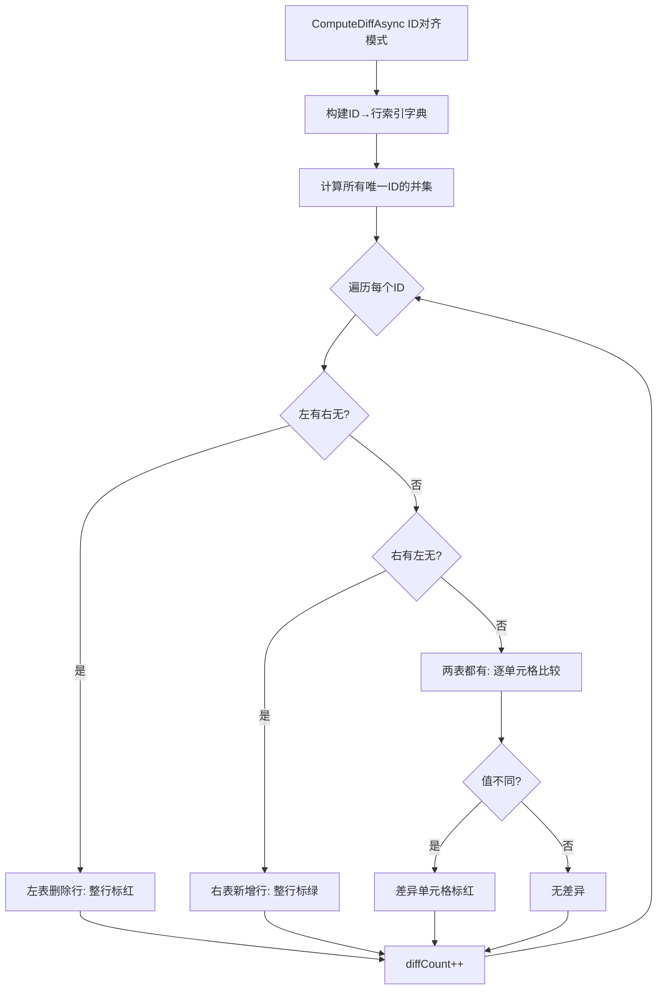
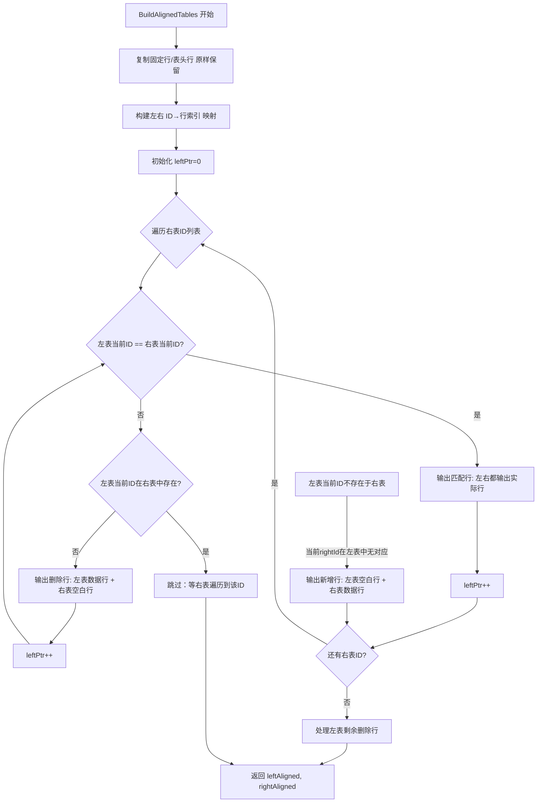

# 版本历史差异化对比 开发指南

> ⚠️ **本模块依赖 TableBrowserControl 对外暴露的 API，修改 TableBrowserControl 时需同步检查本模块是否受影响。**

---

## 1. 概述

- **入口**：CSV/Excel 阅读器 → 文件树右键 → "历史记录对比"（仅在文件所在目录受 SVN/Git 管控时可用）
- **前提条件**：文件所在目录受 SVN 或 Git 管控（`VersionControlHelper.DetectVcs()`）
- **核心功能**：
  1. 展示文件在 SVN/Git 中的完整提交历史
  2. 选择任意两个版本进行左右并排对比
  3. 支持 **行号对齐** 和 **ID对齐** 两种差异计算模式
  4. 差异单元格标红、差异行非差异单元格标浅黄、新增行标浅绿、删除行标浅橙
  5. 支持"仅显示差异行"筛选和"右侧永远显示最新版本"开关
  6. 左右表格同步滚动

### 1.1 入口触发链路

```
[用户右键] → [历史记录对比]
    ↓
[CsvReaderForm / FileBrowserPanel] → 检测 VCS 类型
    ↓
[new VersionCompareForm(filePath, vcsType, frozenRows, headerRowIndex, ...)]
    ↓
[Shown 事件] → LoadHistoryAsync()
```

---

## 2. 涉及文件

| 文件 | 核心类 | 行数 | 职责 |
|------|--------|------|------|
| `VersionCompareForm.cs` | `VersionCompareForm : Form` | ~1930行 | 对比主窗体：历史表格 + 双 TableBrowserControl + 差异计算 + 高亮渲染 + ID对齐归并 |
| `VersionControlHelper.cs` | `VersionControlHelper` (static) / `VcsType` 枚举 | ~450行 | SVN/Git 命令行交互：检测 VCS 类型、拉取历史、导出指定版本 |
| `VersionHistoryEntry.cs` | `VersionHistoryEntry` / `VersionHistoryResult` / `ExportRevisionResult` | ~56行 | 数据模型：版本历史条目、命令执行结果 |
| `FileTableData.cs` | `FileTableData` / `TableRow` / `DiffRowType` 枚举 | ~60行 | 核心数据模型：`IsDiffRow`、`DiffType`、`DiffColumns`、`IsBlankRow`、`OriginalRowIndex` |
| `TableBrowserControl.cs` | `TableBrowserControl`（对外 API） | ~2630行 | `SetDataTable()`、`GetDataGridView()`、`GetFileData()`、`GetColumnCheckStates()`、`GetVisibleColumnIndices()`、`SetColumnVisibility()`、`DetachGridFromParent()`、`AttachGridToParent()`、`OnExternalCellFormatting` 事件 |

---

## 3. 窗体布局架构

```
┌──────────────────────────────────────────────────────────┐
│  [□]仅显示差异行  [□]右侧永远最新  [□]ID对齐匹配  ℹ信息   │  ← _pnlTop (40px)
├──────────────────────────────────────────────────────────┤
│  版本号 │ 提交时间 │ 提交人 │ 提交信息                    │  ← _dgvHistory (DataGridView, ~160px)
├────────────────────────────┬─────────────────────────────┤
│  旧版本 - rXX              │  新版本 - rYY               │  ← _lblLeftHeader / _lblRightHeader (28px)
│                            │                             │
│  TableBrowserControl       │  TableBrowserControl        │  ← _leftView / _rightView
│  (左表)                    │  (右表)                      │
│                            │                             │
└────────────────────────────┴─────────────────────────────┘
```

- `_splitMain`：水平分割（历史表格 / 对比区域），`FixedPanel = Panel1`，SplitterDistance=160
- `_splitCompare`：垂直分割（左表 / 右表），各占 50%
- 左右两侧各有 `TableLayoutPanel`：Row0=标题标签(28px)，Row1=TableBrowserControl(Dock=Fill)

---

## 4. 完整数据流

```mermaid
flowchart TD
    A[用户右键"历史记录对比"] --> B[VersionCompareForm 构造]
    B --> C[Shown 事件 → LoadHistoryAsync]
    C --> D[GetSvnHistoryAsync / GetGitHistoryAsync]
    D --> E[填充 _dgvHistory.DataSource]
    E --> F[选中第0行 → LoadComparisonAsync]

    F --> G[阶段0: DetachGridFromParent 移除 DGV]
    G --> H[阶段1: 并行加载左右 DataTable]
    H --> H1[LoadDataTableAsync leftRevision]
    H --> H2[LoadDataTableAsync rightRevision]
    H1 --> I[_dataCache 缓存检查]
    H2 --> I

    I --> J[阶段2: SetColumnVisibility + SetDataTable]
    J --> J1[保存 _leftFullFileData / _rightFullFileData]
    J --> J2[保存 _savedLeftColStates / _savedRightColStates]

    J2 --> K[阶段3: ComputeDiffAsync ★ 差异计算]
    K --> K1{ID对齐?}
    K1 -->|是| K2[ID对齐模式: 构建ID字典→逐ID比较]
    K1 -->|否| K3[行号对齐模式: 逐行逐列比较]
    K2 --> L[差异回写到 TableRow]
    K3 --> L

    L --> M[阶段3.1: 回写 DiffType 到 TableRow]
    M --> N{ID对齐?}
    N -->|是| N1[阶段3.2: BuildAlignedTables 归并对齐]
    N -->|否| O[阶段3.5: 列显隐投影重建]
    N1 --> O

    O --> P[阶段4: ApplyDiffHighlight 绑定事件]
    P --> Q{diffOnly?}
    Q -->|是| Q1[BuildProjectedFileData diffOnly:true]
    Q -->|否| R[SetupSyncScroll 同步滚动]
    Q1 --> R

    R --> S[finally: AttachGridToParent 一次性渲染]
    S --> T[HideLoading]
```

---

## 5. 差异计算系统（核心！）

### 5.1 数据结构

```csharp
// ★ 差异行原始行号集合（0-based，对应 DataTable.Rows 的索引，包含冻结行）
private HashSet<int> _leftDiffRows = new();
private HashSet<int> _rightDiffRows = new();

// ★ 差异单元格编码集合（(row << 16) | col），使用原始行列索引
private HashSet<int> _leftDiffCells = new();
private HashSet<int> _rightDiffCells = new();

// ★ 新增行/删除行标记（ID对齐模式下使用）
private HashSet<int> _leftDeletedRows = new();   // 左表删除行（右表无对应ID）
private HashSet<int> _rightAddedRows = new();    // 右表新增行（左表无对应ID）

// ★ DGV 行索引 → 原始完整 DataTable 行索引 的映射
private List<int> _leftRowToOriginalIndex = new();
private List<int> _rightRowToOriginalIndex = new();

// ★ DGV 行索引 → 行属性（DiffType + IsBlankRow），用于 OnDiffCellFormatting 直接判断行类型
private List<(DiffRowType diffType, bool isBlankRow)> _leftRowProperties = new();
private List<(DiffRowType diffType, bool isBlankRow)> _rightRowProperties = new();

// ★ DGV 列索引 → 原始完整 DataTable 列索引 的映射
private List<int> _leftColToOriginalIndex = new();
private List<int> _rightColToOriginalIndex = new();

// ★ 完整列数的列隐藏状态（独立保存，不依赖 TableBrowserControl 内部状态）
private bool[]? _savedLeftColStates = null;
private bool[]? _savedRightColStates = null;

private int _diffRowCount = 0;
private bool _diffComputed = false;
```

### 5.2 两种差异计算模式

#### 模式一：行号对齐（`_chkIdAlign` 未勾选 或 未检测到 ID 列）

逐行逐列比较字符串值，从 `dataStartRow`（表头行下一行）开始：

```csharp
int dataStartRow = _headerRowIndex >= 0 ? _headerRowIndex + 1 : _frozenRows;
int maxRows = Math.Max(leftData.Rows.Count, rightData.Rows.Count);

for (int row = dataStartRow; row < maxRows; row++)
{
    for (int col = 0; col < maxCols; col++)
    {
        // 三态判断：
        //   左有右无 → 只加 _leftDiffCells
        //   左无右有 → 只加 _rightDiffCells
        //   两边都有但不同 → 都加
        if (leftVal != rightVal) { /* ... */ }
    }
    if (rowHasDiff) { _leftDiffRows.Add(row); _rightDiffRows.Add(row); }
}
```

**适用场景**：文件结构稳定，行顺序不变，只是内容修改。

#### 模式二：ID 对齐（`_chkIdAlign` 勾选 且 检测到 ID 列）

基于 ID 列的语义匹配（行编辑语义）：

1. 构建 ID → 行索引字典（跳过固定行/表头行）
2. 遍历所有唯一 ID 的并集
3. 判断：
   - **删除行**：左表有、右表无 → 整行标红（所有列加入 `_leftDiffCells`）
   - **新增行**：右表有、左表无 → 整行标绿（所有列加入 `_rightDiffCells`）
   - **修改行**：两表都有 → 逐单元格比较，差异单元格标红



### 5.3 DetectIdColumn 两级回退策略

```csharp
private bool DetectIdColumn(DataTable leftData, DataTable rightData)
{
    // ★ 第一级：优先使用 _uniqueColumnIndex（从配置读取的唯一列索引）
    if (_uniqueColumnIndex >= 0 && _uniqueColumnIndex < minCols)
    {
        _idColumnIndex = _uniqueColumnIndex;
        return true;
    }

    // ★ 第二级：回退到匹配表头行中的关键词
    string[] idKeywords = { "id", "编号", "序号", "key", "code", "编码" };
    for (int c = 0; c < maxCols; c++)
    {
        string leftColName = leftData.Rows[_headerRowIndex][c]?.ToString()?.Trim()?.ToLowerInvariant() ?? "";
        string rightColName = rightData.Rows[_headerRowIndex][c]?.ToString()?.Trim()?.ToLowerInvariant() ?? "";
        // 必须左右表同一列名一致且包含关键词
        if (leftColName == rightColName && idKeywords.Any(k => leftColName.Contains(k)))
        {
            _idColumnIndex = c;
            return true;
        }
    }
    return false;
}
```

**注意**：`DetectIdColumn` 中左右表必须同一列的列名一致才认为匹配，防止因列结构不同导致的误判。

---

## 6. ID 对齐归并算法（BuildAlignedTables）

### 6.1 概述

在 ID 对齐模式下，左右两表的行数可能不同（新增行/删除行导致）。为了让两表行一一对应以便并排显示，需要插入空白占位行。

### 6.2 归并算法详解

**核心思想**：以右表（新版本）ID 顺序为主，左表指针跟随推进。



### 6.3 空白行创建

```csharp
private static TableRow CreateBlankRow(int originalRowIndex, int colCount, DiffRowType oppositeDiffType)
{
    var row = new TableRow
    {
        OriginalRowIndex = -1,        // ★ 空白行无原始行索引
        IsDiffRow = false,
        DiffType = oppositeDiffType,  // ★ 标记对面行的类型
        IsBlankRow = true             // ★ 标记为空白占位行
    };
    // 所有单元格为空字符串
    for (int i = 0; i < colCount; i++)
        row.Cells.Add("");
    return row;
}
```

**空白行 `DiffType` 的含义**：
- `DiffType = Added`：左表空白行 → 对面（右表）是新增行 → 渲染为浅绿色（`_colorBlankRowForAdded`）
- `DiffType = Deleted`：右表空白行 → 对面（左表）是删除行 → 渲染为浅橙色（`_colorBlankRowForDeleted`）

### 6.4 固定行/表头行处理

固定行（冻结行）和表头行不参与 ID 对齐，在两表的对齐结果中原样保留（通过 `OriginalRowIndex < dataStartRow` 判断）。

---

## 7. 差异高亮渲染

### 7.1 颜色定义

```csharp
_colorDiffCellBg       = Color.FromArgb(255, 200, 200);   // 红色：差异单元格
_colorDiffRowBg        = Color.FromArgb(255, 253, 220);   // 浅黄色：差异行的非差异单元格
_colorAddedRowBg       = Color.FromArgb(213, 245, 227);   // 浅绿色：新增行整行
_colorDeletedRowBg     = Color.FromArgb(250, 219, 216);   // 浅橙色：删除行整行
_colorBlankRowForAdded = Color.FromArgb(232, 250, 240);   // 更浅绿：空白行（对面新增）
_colorBlankRowForDeleted=Color.FromArgb(253, 235, 233);   // 更浅橙：空白行（对面删除）
```

### 7.2 OnDiffCellFormatting 完整判断链

```
OnDiffCellFormatting 触发
  │
  ├── 1. IsBlankRow?
  │     ├── DiffType==Added   → 浅绿色（对面新增，本侧空白）
  │     ├── DiffType==Deleted → 浅橙色（对面删除，本侧空白）
  │     └── 其他              → 灰色
  │
  ├── 2. DiffType==Added?
  │     └── 浅绿色整行高亮
  │
  ├── 3. DiffType==Deleted?
  │     └── 浅橙色整行高亮
  │
  └── 4. DiffType==Modified?
        ├── 通过 _leftRowToOriginalIndex[e.RowIndex] 获取原始行索引
        ├── 通过 _leftColToOriginalIndex[e.ColumnIndex] 获取原始列索引
        ├── 编码: cellKey = (originalRow << 16) | originalCol
        ├── cellKey in _leftDiffCells? → 红色
        └── 否则 → 浅黄色
```

### 7.3 事件绑定方式

使用 `TableBrowserControl.OnExternalCellFormatting` 事件（而非直接绑定 DGV.CellFormatting）：

```csharp
view.OnExternalCellFormatting -= OnDiffCellFormatting;  // 先解绑防重复
view.OnExternalCellFormatting += OnDiffCellFormatting;
```

**为什么使用 `OnExternalCellFormatting`？**
- `TableBrowserControl` 内部已有 `OnCellFormatting` 用于列关联高亮
- 在 `OnCellFormatting` 末尾会转发到 `OnExternalCellFormatting`
- 这样外部差异高亮和内部列关联高亮可以共存，互不干扰

---

## 8. 行/列索引映射系统（最复杂！）

### 8.1 四层索引

```
原始 DataTable 行索引 (含冻结行, 0-based)
        │
        ▼ _leftFullFileData  (完整列数的 FileTableData, 含冻结行)
原始 FileTableData 行索引
        │
        ▼ BuildProjectedFileData()  按可见列投影
投影后 FileTableData 行索引 (含冻结行, 含空白行)
        │
        ▼ BuildRowIndexMap()  跳过冻结行
DGV 显示行索引 (不含冻结行)
```

### 8.2 列索引映射

```
原始 DataTable 列索引 (完整列数)
        │
        ▼ _leftColToOriginalIndex[i] = leftVisibleOriginalCols[i]
DGV 显示列索引 → 原始列索引
```

**构建时机**：每次 `SetDataTable` 后立即构建，`_leftColToOriginalIndex` 由可见的原始列索引列表直接赋值。

### 8.3 行属性系统

`_leftRowProperties` / `_rightRowProperties` 存储 DGV 每行的 `(DiffType, IsBlankRow)` 元组：

```csharp
private List<int> BuildRowIndexMap(FileTableData projectedData,
    out List<(DiffRowType diffType, bool isBlankRow)> rowProps)
{
    var map = new List<int>();
    rowProps = new List<(DiffRowType, bool)>();
    // 冻结行模式下跳过冻结行
    for (int i = _frozenRows; i < projectedData.Rows.Count; i++)
    {
        map.Add(projectedData.Rows[i].OriginalRowIndex);
        rowProps.Add((projectedData.Rows[i].DiffType, projectedData.Rows[i].IsBlankRow));
    }
    return map;
}
```

**为什么需要行属性系统？**
- ID 对齐模式下，空白行的 `OriginalRowIndex = -1`，无法通过 `_leftDiffRows.Contains(originalRowIndex)` 判断
- 行属性直接存储每行的类型，`OnDiffCellFormatting` 无需查集合即可判断

### 8.4 为什么需要独立保存 `_savedLeftColStates`？

`TableBrowserControl.SetDataTable()` 会重置 `_columnCheckStates` 为投影后的列数。如果只依赖 `GetColumnCheckStates()`，在后续列显隐切换时，完整列数的状态会丢失。因此需要 `_savedLeftColStates` / `_savedRightColStates` 独立保存完整列数的状态。

**保存时机**：在第一次 `SetDataTable` 之后、列投影之前。
**恢复时机**：在下一次 `SetDataTable` 之前通过 `SetColumnVisibility()` 注入。

---

## 9. 列显隐与差异视图的交互

### 9.1 RefreshDiffView() 完整流程

1. 获取当前列显隐状态（`GetColumnCheckStates()`）—— 基于投影后列数
2. 从 `_leftColToOriginalIndex` 获取原始列索引
3. 根据当前显隐状态筛选出可见的原始列索引
4. 调用 `BuildProjectedFileData(_leftFullFileData, visibleOriginalCols, diffOnly)` 重新投影
5. `SetColumnVisibility()` + `SetDataTable()` 重新注入
6. 重建 `_leftRowToOriginalIndex` / `_leftRowProperties` / `_leftColToOriginalIndex`
7. 重新绑定 `ApplyDiffHighlight()`

### 9.2 BuildProjectedFileData 中 IsBlankRow 的特殊处理

```csharp
// ★ 固定行（冻结行）始终保留，不受 diffOnly 影响
// ★ 空白行始终保留，否则对面有数据行但空白行被过滤导致行不对齐
bool isFrozenRow = srcRow.OriginalRowIndex < _frozenRows;
bool isBlankRow = srcRow.IsBlankRow;
if (diffOnly && !srcRow.IsDiffRow && !isFrozenRow && !isBlankRow) continue;
```

**关键设计**：空白行在 `diffOnly=true` 时也必须保留，否则左右两表的行数不再一致，滚动同步会错位。

### 9.3 关键注意事项

- **不能直接用 `GetVisibleColumnIndices()`**：它返回投影后的列索引（0~N-1），而 `_leftFullFileData` 是完整列数的数据
- **必须用原始列索引**：通过 `_leftColToOriginalIndex` 映射回原始列
- **冻结行在投影中始终保留**：`diffOnly: true` 时不跳过冻结行

---

## 10. 版本控制系统交互

### 10.1 VCS 检测

```csharp
// VersionControlHelper.DetectVcs(filePath)
// 从文件目录向上遍历，查找 .svn 或 .git 目录
```

### 10.2 历史记录拉取

| VCS | 命令 | 解析方式 |
|-----|------|----------|
| SVN | `svn log --xml -l 100 "filePath"` | XML 解析 `logentry` 元素 |
| Git | `git log --follow --pretty=format:%H|%h|%ai|%an|%s -100 -- "relativePath"` | 按 `|` 分割 |

### 10.3 版本文件导出

| VCS | 命令 |
|-----|------|
| SVN | `svn cat -r REV "filePath"` |
| Git | `git show "REV:relativePath"` |

### 10.4 命令行可用性检查

- SVN：查找 `svn.exe`（TortoiseSVN/SlikSVN/VisualSVN 安装路径）+ 运行 `svn --version` 验证
- Git：直接运行 `git --version` 验证

---

## 11. 缓存机制

- `_dataCache: Dictionary<string, CachedVersionData>` — 最多缓存 10 个版本，每项是 `(DataTable Table, FileTableData Data)`；`Data` 是解析出来的源文件物理行号载体，行号显示靠它
- 命中缓存时 `FileTableData` 要先 `FileDataCache.CloneFileData()` 再交给视图：对比过程会把差异标记写回 `_leftFullFileData`，不复制就会污染缓存（`DataTable` 可以共享，嵌入模式禁止编辑）
- Key 格式：
  - 历史版本：SVN revision 号或 Git 完整 SHA
  - 当前文件：`"__CURRENT_FILE__"`
- LRU 淘汰：超过 10 个时移除第一个（最早插入的）
- 临时文件目录 `_tempDir`：`%TEMP%/wxd_vcs_diff_{GUID}/`
- 关闭时 `CleanupTempFiles()` 清理

---

## 12. 同步滚动

```csharp
private bool _syncingScroll;  // 防递归标志

// OnLeftGridScroll:
//   垂直: rightDgv.FirstDisplayedScrollingRowIndex = leftDgv.FirstDisplayedScrollingRowIndex
//   水平: rightDgv.HorizontalScrollingOffset = leftDgv.HorizontalScrollingOffset

// OnRightGridScroll: 反向同步
```

**关键**：`_syncingScroll` 必须在 `finally` 块中重置为 `false`，防止异常导致滚动永久失效。

---

## 13. Loading 动画

### 13.1 独立 STA 线程

```csharp
_loadingThread = new Thread(() =>
{
    _loadingForm = new LoadingForm();
    Application.Run(_loadingForm);
});
_loadingThread.SetApartmentState(ApartmentState.STA);
_loadingThread.IsBackground = true;
_loadingThread.Start();
```

**原理**：Windows Forms 需要 STA 线程来运行消息泵。`LoadingForm` 在独立线程中运行，即使主 UI 线程被同步操作阻塞，旋转动画也能持续转动。

### 13.2 关键实现细节

- 父窗体 `Enabled = false` 阻止用户交互
- 通过 `BeginInvoke` 跨线程关闭 LoadingForm
- 支持动态更新详情文字：`_loadingForm.SetDetail(text)`
- 动画使用 `System.Windows.Forms.Timer`，~60 FPS（Interval=16ms）

---

## 14. DGV 挂载优化

### 14.1 DetachGridFromParent / AttachGridToParent

```csharp
public void DetachGridFromParent()
{
    gridParent.Controls.Remove(_dataGrid);
    gridHeaderParent.Controls.Remove(_dataGridHeader);
}

public void AttachGridToParent()
{
    if (!_pnlGridContainer.Panel2.Controls.Contains(_dataGrid))
        _pnlGridContainer.Panel2.Controls.Add(_dataGrid);
    // ...
}
```

**原理**：
- `SetDataTable()` 触发 `DataSource` 赋值 → DataGridView 逐行创建并绘制
- 如果 DGV 在界面中可见，每次 `SetDataTable` 都会触发一次完整的布局和绘制周期
- 先移除 DGV → 设置数据 → 再加回界面，让渲染只发生一次

**使用位置**：`LoadComparisonAsync` 中：
- 阶段0：`DetachGridFromParent()`
- finally：`AttachGridToParent()`

---

## 15. 数据解析

### 15.1 CSV 解析
- `ReadCsvToDataTable()`：自动检测分隔符（`,`、`\t`、`;`、`|`）、支持引号转义、UTF-8 编码
- 列名去重：同名列追加 `_1`, `_2` 后缀

### 15.2 Excel 解析
- `ReadExcelToDataTable()`：使用 `ExcelDataReader`，列名使用 A, B, C... 格式
- `GetExcelColumnName(int columnIndex)`：0→A, 25→Z, 26→AA...

---

## 16. TableBrowserControl 对外 API 依赖

版本对比依赖 `TableBrowserControl` 的以下 API：

| API | 用途 | 注意事项 |
|-----|------|----------|
| `SetDataTable(DataTable, string, FileTableData?)` | 注入数据 | 第三个参数传入解析结果才能保留源文件物理行号；行数不匹配时视图自动退回按行索引重建。会重置 `_columnCheckStates`，需配合 `_savedLeftColStates` |
| `GetDataGridView()` | 获取内部 DGV | 用于绑定 Scroll/CellFormatting 事件 |
| `GetFileData()` | 获取 FileTableData | 保存为 `_leftFullFileData` / `_rightFullFileData` |
| `GetColumnCheckStates()` | 获取列显隐状态 | 投影后列数，需配合 `_savedLeftColStates` |
| `GetVisibleColumnIndices()` | 获取可见列索引 | 投影后索引，**不能直接用于访问完整数据** |
| `SetColumnVisibility(bool[])` | 设置列显隐状态 | 通过 `_externalColumnStates` 机制，在下次 `SetDataTable` 时生效 |
| `DetachGridFromParent()` | 移除 DGV | 防止设置 DataSource 时逐行绘制 |
| `AttachGridToParent()` | 加回 DGV | 一次性渲染 |
| `OnExternalCellFormatting` 事件 | 差异高亮回调 | 先解绑再绑定防重复 |
| `FrozenRows` 属性 | 获取固定行数 | 供版本对比计算行号映射 |

### 16.1 `_externalColumnStates` 机制

```csharp
// TableBrowserControl.SetColumnVisibility:
public void SetColumnVisibility(bool[]? states)
{
    _externalColumnStates = states;  // 暂存
}

// TableBrowserControl.SetDataTable:
if (_externalColumnStates != null && _externalColumnStates.Length == _dataTable.Columns.Count)
{
    _columnCheckStates = (bool[])_externalColumnStates.Clone();
    _externalColumnStates = null;  // ★ 只使用一次，避免影响后续调用
}
```

**关键设计**：`_externalColumnStates` 是一次性的，在 `SetDataTable` 中被消费后立即清空，防止下次 `SetDataTable` 错误地使用旧状态。

---

## 17. 修改禁区

1. **不要改变 `(row << 16) | col` 编码方式** — 差异单元格的编码格式，任何修改都会导致高亮失效
2. **`BuildRowIndexMap()` 中冻结行偏移不能动** — 冻结行模式下的行映射必须跳过 `_frozenRows`
3. **`RefreshDiffView()` 中列映射重建顺序不可改变** — 必须先获取原始列索引，再根据显隐状态筛选
4. **`_savedLeftColStates` 的保存/恢复时机不可错位** — 在 `SetDataTable()` 之后保存（完整列数），在下一次 `SetDataTable()` 之前通过 `SetColumnVisibility()` 恢复
5. **`ComputeDiffAsync()` 中的三态判断不能合并** — 左有右无、左无右有、两边都有但不同，必须分别处理
6. **`BuildProjectedFileData()` 中冻结行不能受 `diffOnly` 影响** — 冻结行始终保留
7. **`BuildProjectedFileData()` 中空白行不能受 `diffOnly` 影响** — 否则左右行数不一致
8. **`_dataCache` 的 Key 格式不能修改** — `"__CURRENT_FILE__"` 和版本号的区分逻辑依赖此格式
9. **不要直接使用 `GetVisibleColumnIndices()` 访问完整数据** — 它返回的是投影后索引，需用 `_leftColToOriginalIndex` 映射
10. **`TableBrowserControl.OnExternalCellFormatting` 必须先解绑再绑定** — 防止多次绑定导致颜色叠加错误
11. **临时文件目录 `_tempDir` 的命名格式不能改变** — 关闭时依赖此格式清理
12. **`DetectIdColumn` 中左右表列名一致性检查不能移除** — 防止因列结构不同导致的误判
13. **`BuildAlignedTables` 中归并算法不能改变遍历顺序** — 以右表ID顺序为主，左表指针跟随
14. **空白行 `OriginalRowIndex = -1` 的设计不能修改** — 高亮渲染依赖此判断空白行
15. **`_externalColumnStates` 的一次性消费机制不能改变** — 在 `SetDataTable` 中消费后必须清空
16. **交给视图的 `FileTableData` 必须是 `CloneFileData()` 副本** — 差异标记会写回 `_leftFullFileData`，直接共用缓存项会让下次对比带着上次的差异
17. **空白占位行不要伪造行号** — `CreateBlankRow` 保持 `PhysicalStartLine = -1` + `IsBlankRow = true`，`DisplayLineNumber` 返回 `null`，行号区画 `—`；填 `OriginalRowIndex` 会让它显示成记录序号，看起来像真实行号

---

## 18. 常见 Bug 模式

| 问题 | 原因 | 修复方式 |
|------|------|----------|
| 差异高亮颜色错位 | 列隐藏后 `e.ColumnIndex` 与原始列索引不对应 | 使用 `_leftColToOriginalIndex` 映射 |
| "仅显示差异行"勾选后数据变少 | `BuildProjectedFileData` 未正确判断 `IsDiffRow` | 确保差异信息已回写到 `TableRow.IsDiffRow` |
| 切换版本后列显隐状态丢失 | `SetDataTable()` 重置了 `_columnCheckStates` | 使用 `_savedLeftColStates` 独立保存 |
| 滚动不同步 | `_syncingScroll` 未正确设置 | 确保 `finally { _syncingScroll = false; }` |
| 对比视图行号全是记录序号 | `SetDataTable` 没传 `FileTableData`，视图只能按行索引重建 | 把解析出的 `FileTableData`（克隆件）作为第三个参数注入 |
| 多次绑定事件导致颜色叠加 | `OnExternalCellFormatting` 重复绑定 | 每次绑定前先 `-=` 解绑 |
| 加载时界面卡死 | 主线程阻塞 + LoadingForm 在同一线程 | LoadingForm 在独立 STA 线程运行 |
| ID对齐后行数不一致 | 空白行在 `diffOnly=true` 时被过滤 | `BuildProjectedFileData` 中 `IsBlankRow` 始终保留 |
| 列隐藏后差异高亮完全失效 | 使用投影后索引访问 `_leftDiffCells` | 通过 `_leftColToOriginalIndex` 映射到原始列索引 |
| 右侧永远最新勾选后切换版本不刷新 | 选中版本未变化但右侧应切换 | 检查 `LoadComparisonAsync` 去重逻辑 |
| 归并后左右表行数不一致 | 固定行/表头行参与了归并 | `dataStartRow` 跳过固定行和表头行 |

---

## 19. 调试技巧

### 19.1 关键 Debug 输出位置

在以下位置添加 `Debug.WriteLine` 有助于诊断问题：

```csharp
// ComputeDiffAsync 开始
Debug.WriteLine($"[ComputeDiff] mode={(useIdAlign ? "ID" : "Row")}, idCol={_idColumnIndex}");

// BuildAlignedTables 归并
Debug.WriteLine($"[Align] left rows={leftAligned.Rows.Count}, right rows={rightAligned.Rows.Count}");

// 差异单元格编码
Debug.WriteLine($"[DiffCell] row={row}, col={col}, key={(row << 16) | col}");

// OnDiffCellFormatting 判断
Debug.WriteLine($"[Highlight] row={e.RowIndex}, col={e.ColumnIndex}, "
    + $"origRow={originalRowIndex}, origCol={originalColIndex}, "
    + $"diffType={diffType}, isBlank={isBlankRow}, cellKey={cellKey}");
```

### 19.2 快速验证清单

- [ ] `_leftRowToOriginalIndex.Count == _rightRowToOriginalIndex.Count`（ID对齐模式下）
- [ ] `_leftColToOriginalIndex.Count == leftVisibleCols.Count`
- [ ] `_leftRowProperties.Count == _leftRowToOriginalIndex.Count`
- [ ] `_savedLeftColStates.Length == 完整列数`
- [ ] `_leftFullFileData.ColumnNames.Count == 完整列数`
- [ ] ID对齐后 `leftAligned.Rows.Count == rightAligned.Rows.Count`
